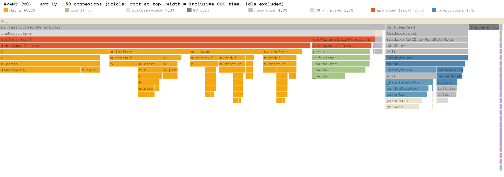
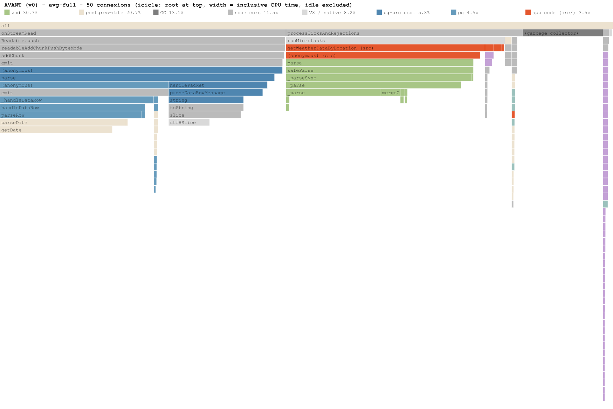
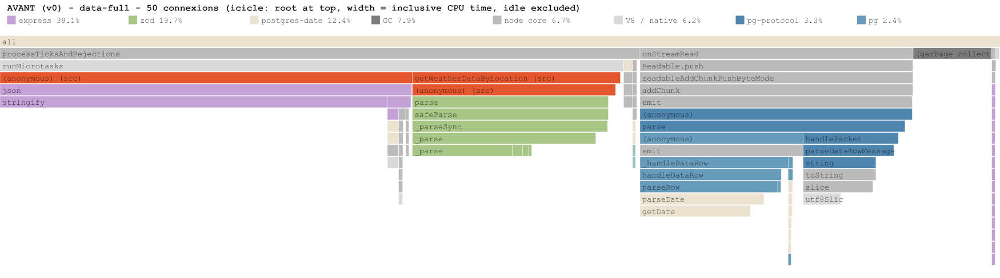
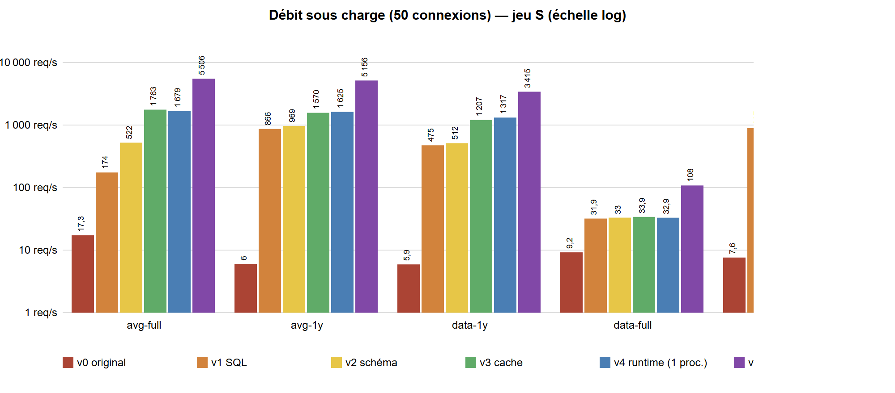
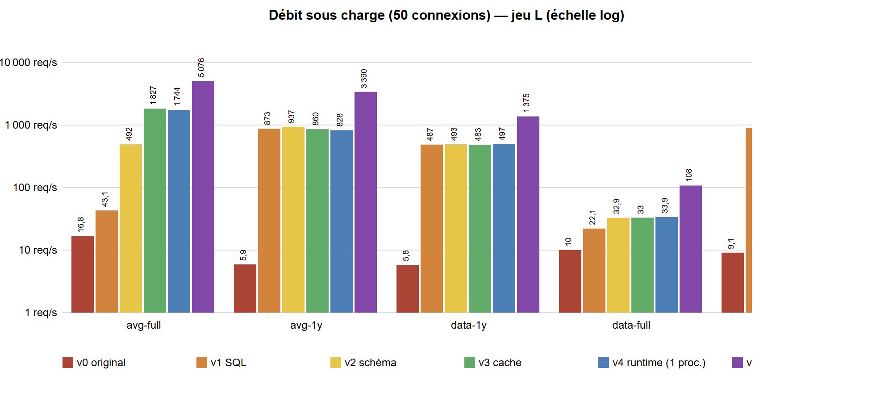
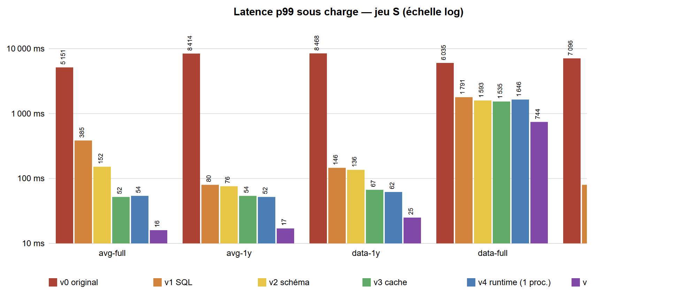
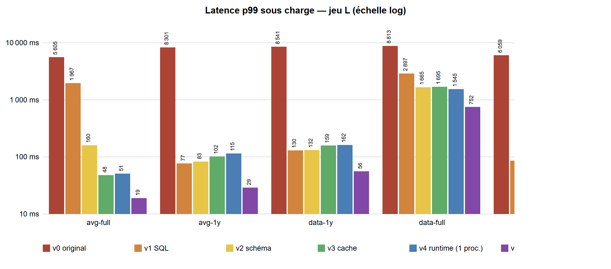
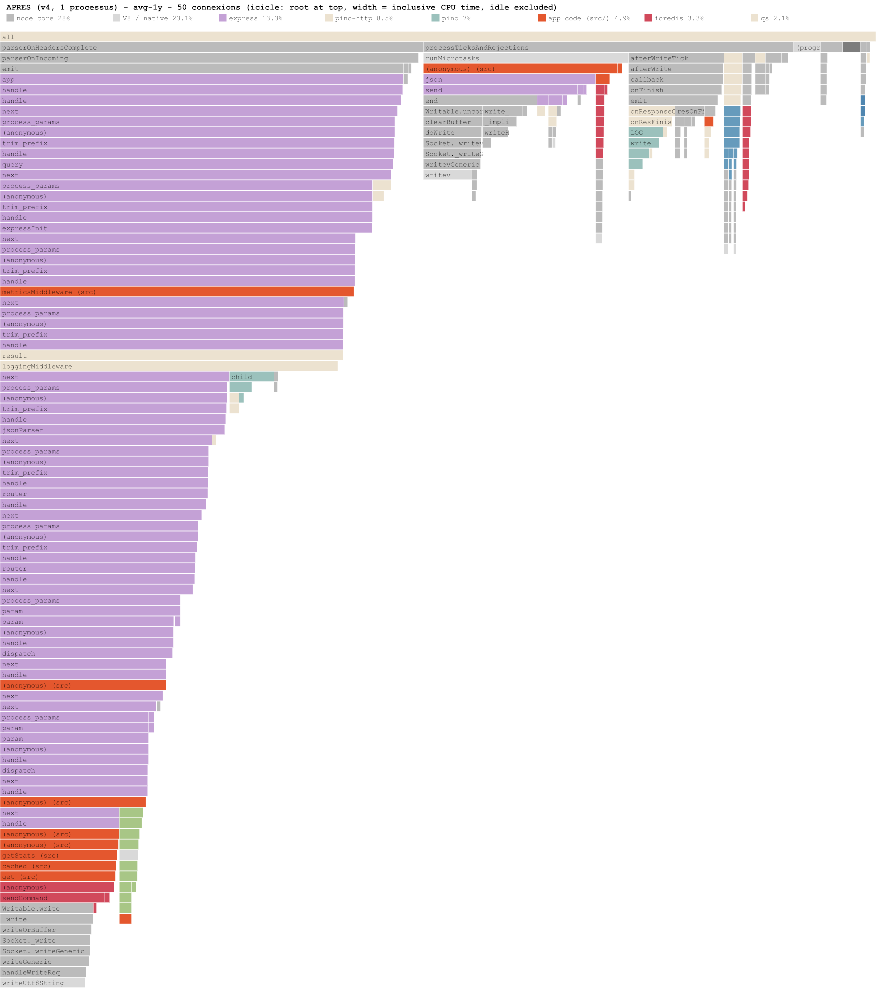
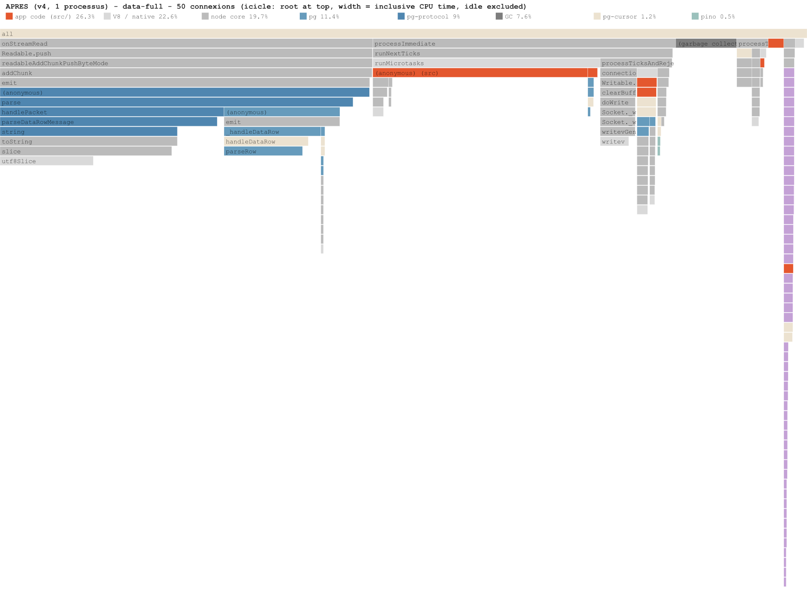
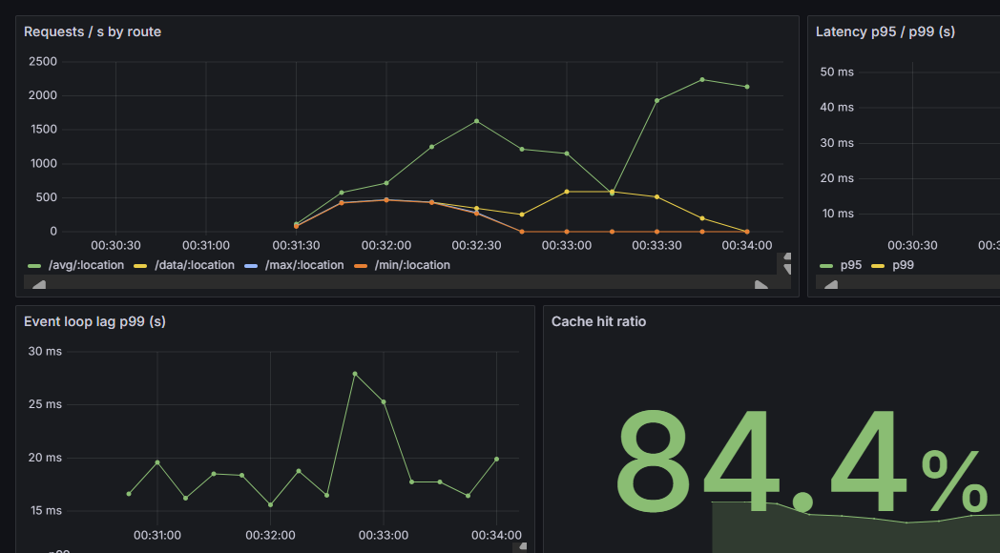

<!-- pdf:skip-start -->
# 5PERF — Audit de performance WeatherTrack Pro

**Rapport complet : audit (avant) → optimisations (après) → recommandations**

Réalisation : Juillard Alexandre · Kouachi Renda · Monnier Thonin — Supinfo Lyon, 2026
<!-- pdf:skip-end -->

### Fiche du projet

| Élément | Détail |
|---|---|
| Application | WeatherTrack Pro — backend Node.js / Express / PostgreSQL |
| Périmètre | API de récupération (`/weather/data`) et d'analyse (`/weather/avg`, `/min`, `/max`) des données météorologiques historiques |
| Version auditée | `v0-baseline` (commit `3d57400`, code fourni) |
| Version livrée | `v4-runtime` (+ outillage de mesure, migrations, tests) |
| Historique | une étape = un commit + un tag git : `v0-baseline` → `v1-sql` → `v2-schema` → `v3-cache` → `v4-runtime` |
| Figures | sources PNG et SVG dans `docs/assets/` |

> **Comment lire ce rapport.** Le document suit une logique « avant / après ». Les chapitres 1 et 2 présentent la méthode de travail et l'état initial de l'application ; le chapitre 3 décrit les corrections apportées et leur effet mesuré, étape par étape ; le chapitre 4 détaille la réorganisation des données ; le chapitre 5 compare l'avant et l'après ; les chapitres 6 et 7 traitent des conséquences pour les utilisateurs de l'API et des recommandations pour la suite. Les encadrés « En clair » résument, en termes non techniques, ce qu'il faut retenir de chaque tableau ou graphique.

---

## Sommaire

0. [Résumé de l'intervention](#0-résumé-de-lintervention)
1. [Contexte, méthodologie et outillage](#1-contexte-méthodologie-et-outillage)
2. [AVANT — Audit de performance](#2-avant--audit-de-performance)
3. [APRÈS — Optimisations réalisées](#3-après--optimisations-réalisées)
4. [Migration des données](#4-migration-des-données)
5. [Comparatif avant / après](#5-comparatif-avant--après)
6. [Changements de contrat d'API](#6-changements-de-contrat-dapi)
7. [Recommandations](#7-recommandations)
8. [Annexes](#8-annexes)

---

## 0. Résumé de l'intervention

**Constat.** L'API calculait chaque analyse en chargeant **tout l'historique** de la ville demandée (≈ 11 000 lignes
pour 30 ans), puis en le validant, le convertissant et le filtrant **ligne par ligne en JavaScript** (zod, dayjs),
dans l'unique thread de Node.js. Plus de 80 % du CPU était consommé par ce travail inutile. Sous une charge modeste
(50 utilisateurs simultanés), un serveur ne traitait que **6 à 17 requêtes par seconde**, avec des temps de réponse de
**5 à 9 secondes** (p99) et un event loop bloqué jusqu'à 9 secondes. La base de données, mal organisée physiquement
pour ces lectures, lisait **une page disque par ligne**. Six bugs fonctionnels ont également été trouvés (erreurs 500
sur une période vide, dates décalées selon le fuseau horaire, etc.).

**Actions**, par ordre de rentabilité, chacune mesurée. Chaque version représente des actions réparties par priorité et impact sur le business de l'application :

| Étape | Contenu | Effet principal mesuré |
|---|---|---|
| **v1** | calculs et filtres délégués à PostgreSQL, suppression du travail par ligne, pagination, export en streaming, bugs corrigés | **×80 à ×148** sur les analyses et récupérations sur une période ; event loop p99 : 8,4 s → 23 ms |
| **v2** | migration du schéma : table `locations`, partitionnement annuel, index couvrant, données réordonnées (11 M lignes migrées en 83 s) | historique complet sur L : **×11** (43 → 492 req/s) ; pages lues par requête : 11 003 → 183 |
| **v3** | cache Redis (invalidation par ville, anti-effet troupeau, tolérant aux pannes), cache HTTP | requêtes répétées : **×1,5 à ×3,7** |
| **v4** | JavaScript compilé, cluster multi-cœurs, logs asynchrones, métriques Prometheus, arrêt maitrisé, tests, 0 vulnérabilité | **×2,6 à ×4,1** (4 cœurs) ; mémoire −40 % par processus ; démarrage 4,6 s → 2,0 s |

> **En clair.** Le travail a été mené en quatre étapes successives, de la plus rentable à la plus structurelle. La première, qui consiste simplement à « laisser la base de données faire les calculs » au lieu de rapatrier toutes les données sur le serveur, apporte à elle seule l'essentiel du gain. Les étapes suivantes consolident ce résultat : réorganisation des données, mémorisation des réponses fréquentes, puis exploitation de tous les cœurs du processeur.

**Résultat global (version d'origine → version finale, 4 processus) :**

| Scénario | Jeu | v0 req/s | v4 cluster req/s | Gain débit | v0 p99 | v4 cluster p99 | v0 latence unitaire | v4 latence unitaire |
|---|---|---:|---:|---:|---:|---:|---:|---:|
| Moyenne, historique complet (30 ans) | S | 17,3 | 5 506 | **×318** | 5 151 ms | 16 ms | 64 ms | 2 ms |
| Moyenne, historique complet (30 ans) | L | 16,8 | 5 076 | **×302** | 5 605 ms | 19 ms | 107 ms | 2 ms |
| Moyenne, 1 an | S | 6 | 5 156 | **×859** | 8 414 ms | 17 ms | 163 ms | 2 ms |
| Moyenne, 1 an | L | 5,9 | 3 390 | **×575** | 8 301 ms | 29 ms | 210 ms | 6 ms |
| Données brutes, 1 an | S | 5,9 | 3 415 | **×579** | 8 468 ms | 25 ms | 178 ms | 3 ms |
| Données brutes, 1 an | L | 5,8 | 1 375 | **×237** | 8 541 ms | 56 ms | 212 ms | 7 ms |
| Export historique complet | S | 9,2 | 108 | **×12** | 6 035 ms | 744 ms | 104 ms | 45 ms |
| Export historique complet | L | 10 | 108 | **×11** | 8 813 ms | 752 ms | 136 ms | 46 ms |
| Requêtes populaires (mix) | S | 7,6 | 4 991 | **×657** | 7 096 ms | 17 ms | 115 ms | 2 ms |
| Requêtes populaires (mix) | L | 9,1 | 5 084 | **×559** | 6 059 ms | 17 ms | 114 ms | 2 ms |

> **En clair.** Sur une même machine, l'application traite désormais en une seconde ce qui lui demandait auparavant plusieurs minutes. Là où un serveur répondait à environ 17 demandes d'analyse par seconde, il en sert aujourd'hui plus de 5 000 ; sous forte affluence, le temps d'attente ressenti par un utilisateur passe de 5 à 9 secondes à quelques centièmes de seconde. Seul l'export de l'historique complet reste une opération « lourde » (moins d'une seconde), ce qui s'explique par le volume de données transmis ; une piste d'amélioration est proposée dans les recommandations.

- **Capacité** : ×237 à ×859 sur les analyses et récupérations, ×11 à ×12 sur l'export complet ; **par cœur de
  CPU**, la version finale traite 140 à 270 fois plus de requêtes d'analyse que l'originale.
- **Expérience utilisateur** : un utilisateur seul obtient une analyse en **2 à 7 ms** au lieu de 64 à 212 ms ;
  sous charge, 99 % des réponses arrivent en moins de **60 ms** (au lieu de 5 à 9 s), hors export complet.
- **Fiabilité** : plus aucune erreur sous charge (16 erreurs/timeouts sur L avant), plus d'erreur 500 sur les périodes
  vides, arrêt gracieux, tolérance à la panne du cache, résultats identiques à l'original (1 170 comparaisons, 0 écart).
- **Scalabilité** : la latence d'une analyse ne croît plus avec l'ancienneté des données ni avec la taille de la base
  (sans cache, en mono-processus — v2 —, S et L donnent les mêmes débits à ±6 %), et la capacité augmente avec le
  nombre de cœurs.
  Limite identifiée : avec 4 workers sur L, la base (4 CPU) redevient le facteur limitant pour les requêtes
  aléatoires non mises en cache (recommandations R1, R4, R5).
- **Pilotage** : métriques (latence par route, event loop, pool, cache), tableau de bord Grafana, 18 tests
  automatisés, outillage de mesure conservé dans le dépôt pour éviter les régressions.

**Principales recommandations restantes** (§ 7) : pré-agrégats mensuels pour les analyses longues, exports
asynchrones vers un stockage objet, PgBouncer et réplicas en lecture, réglage de PostgreSQL, traçage
OpenTelemetry avec SLO, budgets de performance en CI.

---

## 1. Contexte, méthodologie et outillage

### 1.1 L'application avant intervention

WeatherTrack Pro expose des données météorologiques journalières (température, humidité) par ville, et des
analyses (moyenne, minimum, maximum) sur une période. Le code d'origine comporte 9 fichiers :

```
src/index.ts             démarrage : CREATE TABLE IF NOT EXISTS, listen
src/server.ts            express() + morgan + body-parser + app
src/app.ts               express() monté sur /weather
src/weather/controller.ts  express() (3e application imbriquée), 5 routes
src/weather/service.ts   filtrage par dates (dayjs) et calculs avg/min/max en JavaScript
src/weather/repository.ts  pg.Pool, SELECT * ... WHERE location = $1, zod.parse() par ligne
src/weather/dto.ts       schémas zod
src/logger.ts, src/apiLogger.ts  winston (console) + morgan
```

**Chemin d'une requête `GET /weather/avg/Lyon?from=2023-01-01&to=2023-12-31` (v0) :**

```
HTTP ─► morgan ─► body-parser ─► express(app) ─► express(controller) ─► validateRequest (zod, sans transformation)
   ─► service.getMean ─► service.getData ─► repository.getWeatherDataByLocation
        SQL : SELECT * FROM weather WHERE location = 'Lyon'          ◄── TOUT l'historique de la ville (≈11 000 lignes)
        pg  : DECIMAL → string, DATE → new Date() (postgres-date)    ◄── 11 000 objets Date
        zod : WeatherDataSchema.parse(row) × 11 000                  ◄── coercitions + objets intermédiaires
   ─► data.filter(dayjs(from).isAfter(d) || dayjs(from).isSame(d) || dayjs(to).isBefore(d))
                                                                     ◄── jusqu'à 6 objets dayjs par ligne
   ─► data.map(t => t.temperature).reduce(+) / length               ◄── tableau intermédiaire
   ─► res.json({ avg })                                              ◄── 1 nombre renvoyé
```

Une requête dont la réponse est **un seul nombre** transfère et transforme **l'historique complet** de la ville, dans
l'unique thread de Node.js.

### 1.2 Environnement de mesure

| Élément | Valeur |
|---|---|
| Machine | AMD Ryzen AI 9 HX 370 (12 cœurs / 24 threads), 31 Go RAM, Windows, ordinateur portable |
| Node.js | v22.23.4 (le `package.json` imposait 20.10.0 ; le code fonctionne à l'identique sur les deux) |
| PostgreSQL | 16 (alpine) sous Docker Desktop, **limité à 4 CPU et 4 Go** (`docker-compose.yml`), configuration par défaut |
| Redis | 7 (alpine), `maxmemory 256mb`, `allkeys-lru`, sans persistance |
| Générateur de charge | autocannon (même machine, 50 connexions simultanées) |

L'environnement est **identique pour toutes les versions mesurées** (même conteneur, même configuration
PostgreSQL), afin d'isoler l'effet des modifications du code et du schéma.

### 1.3 Jeux de données

Les données réelles n'étant pas accessibles, deux jeux synthétiques reproductibles ont été générés
([`scripts/seed-legacy.sql`](../scripts/seed-legacy.sql), [`scripts/seed.mjs`](../scripts/seed.mjs)) sur le
**schéma d'origine** :

| Jeu | Villes | Période | Lignes | Taille (table + index) | Génération |
|---|---:|---|---:|---:|---:|
| **S** | 100 | 1995 → 2024 (30 ans, 1 mesure/jour) | 1 095 800 | 96 Mo | 14 s |
| **L** | 1 000 | 1995 → 2024 | 10 958 000 | 1 064 Mo | 122 s |

- Températures saisonnières (sinusoïde annuelle + décalage par ville + bruit déterministe `hashtext`), humidité
  bruitée, valeurs à 1 décimale.
- **Ordre d'insertion réaliste** : jour par jour, toutes les villes à la suite (comme les robots d'ingestion).
  Conséquence physique importante : les lignes d'une même ville sont **dispersées dans toute la table** (une
  ligne par page de 8 Ko sur L). Ce point a été vérifié (`Heap Blocks: exact=10958` pour une ville) et il est
  central dans l'analyse (§ 2.4).
- S et L ont la même profondeur d'historique par ville (~11 000 lignes) : une requête « par ville » manipule le
  même volume ; la différence est la **taille totale** (cache mémoire de PostgreSQL vs lectures disque) et le
  **nombre de clés** distinctes (efficacité du cache applicatif).

> **En clair.** Faute d'accès aux données réelles, deux jeux de données réalistes ont été fabriqués : un « petit » (S, 100 villes) et un « grand » (L, 1 000 villes), couvrant chacun 30 ans de relevés quotidiens. Comparer les deux permet de vérifier si l'application ralentit lorsque la base de données grossit — c'est précisément le problème rencontré par WeatherTrack Pro.

### 1.4 Outillage

| Besoin | Outil utilisé | Fichier |
|---|---|---|
| Charge HTTP, latences p50/p90/p99, débit | **autocannon** (API programmatique, requêtes pseudo-aléatoires déterministes) | [`bench/load.mjs`](../bench/load.mjs) |
| Event loop, CPU, mémoire **sans modifier le code mesuré** | `perf_hooks.monitorEventLoopDelay()`, `process.cpuUsage()`, `process.memoryUsage()` dans un module préchargé (`node --import`) | [`bench/monitor.mjs`](../bench/monitor.mjs) |
| Profilage CPU sous charge | profiler V8 via `node:inspector` (équivalent `--cpu-prof`, déclenché à chaud) → `.cpuprofile` | `bench/monitor.mjs` `/profile` |
| Flamegraphs, répartition du CPU par paquet | générateur maison `.cpuprofile` → SVG + tableau | [`bench/profile-report.mjs`](../bench/profile-report.mjs) |
| Heap snapshots | `v8.writeHeapSnapshot()` | `bench/monitor.mjs` `/heap` |
| Micro-benchmarks (implémentation A vs B) | **mitata** | [`bench/micro.bench.mjs`](../bench/micro.bench.mjs) |
| Plans d'exécution SQL | `EXPLAIN (ANALYZE, BUFFERS)`, `pg_stat_statements` | [`bench/db-compare.mjs`](../bench/db-compare.mjs) |
| Latence réseau Node ↔ PostgreSQL | script dédié | [`bench/db-latency.mjs`](../bench/db-latency.mjs) |
| Campagne complète reproductible | orchestrateur (git worktrees par version) | [`bench/campaign.mjs`](../bench/campaign.mjs) |
| Non-régression fonctionnelle v0 ↔ v4 | comparaison de réponses sur 1 170 requêtes aléatoires | [`bench/compare-versions.mjs`](../bench/compare-versions.mjs) |
| Tests | **Jest** + ts-jest (ESM) + **supertest** | [`test/`](../test) |
| Observabilité en production | **prom-client** + Prometheus + Grafana, **pino** | [`src/metrics.ts`](../src/metrics.ts), [`monitoring/`](../monitoring) |
| Qualité / sécurité | **ESLint** (typescript-eslint + **sonarjs**), **depcheck**, **npm audit** | [`.eslintrc.json`](../.eslintrc.json) |

> **En clair.** Chaque outil répond à une question précise : « combien de demandes le serveur supporte-t-il ? » (tests de charge), « à quoi le processeur consacre-t-il son temps ? » (profilage), « quelle quantité de données la base lit-elle ? » (plans d'exécution), « les résultats sont-ils toujours justes ? » (tests et comparaisons automatiques). Tous ces outils sont conservés dans le projet afin que les mesures puissent être refaites à tout moment.

### 1.5 Protocole de mesure

Pour chaque version et chaque jeu de données ([`bench/campaign.mjs`](../bench/campaign.mjs)) :

1. Démarrage de la version depuis son tag git (worktree dédié, ses propres dépendances), base correspondante
   (schéma d'origine pour v0/v1, schéma migré pour v2+), Redis vidé, moniteur préchargé.
2. Pour chacun des 5 scénarios :
   - **échauffement** 3 s (JIT, pool de connexions, caches) — non mesuré ;
   - **latence unitaire** : 1 connexion pendant 6 s → ce que perçoit un utilisateur seul ;
   - **charge** : 50 connexions pendant 10 s, **3 répétitions**, on retient la **médiane** (débit) ;
     le moniteur fournit pour la même fenêtre le délai de l'event loop (p99), le CPU et la mémoire maximale.
3. Les requêtes sont pseudo-aléatoires mais **identiques d'une version à l'autre** (générateur à graine fixe).

| Scénario | Requête | Représente |
|---|---|---|
| `avg-full` | `GET /weather/avg/{ville}` | analyse sur tout l'historique (30 ans) |
| `avg-1y` | `GET /weather/avg/{ville}?from=Y-01-01&to=Y-12-31` | analyse sur une période (cas le plus courant) |
| `data-1y` | `GET /weather/data/{ville}?from=...&to=...` (365 lignes) | récupération de données |
| `data-full` | v0 : `GET /weather/data/{ville}` ; après : `GET /weather/export/{ville}` (≈11 000 lignes, même contenu) | export complet |
| `hot` | 65 requêtes « populaires » tirées au hasard (5 villes, années récentes) | trafic réel, favorable au cache |

> **En clair.** Les cinq scénarios reproduisent les usages typiques des clients : un chercheur qui calcule une moyenne sur 30 ans, un agriculteur ou un organisateur d'événements qui consulte une année précise, un utilisateur qui télécharge des relevés bruts, un export complet destiné à une analyse externe, et enfin le trafic réel, où une poignée de questions populaires représente l'essentiel des demandes. Chaque scénario est d'abord joué par un utilisateur seul (temps de réponse « idéal »), puis par 50 utilisateurs simultanés (tenue en charge).

> **Comment lire les tableaux de mesures.**
>
> - **Débit (req/s)** : nombre de demandes traitées par seconde — plus il est élevé, mieux c'est.
> - **Latence p50** : temps de réponse « typique » (la moitié des utilisateurs attendent moins longtemps) ; **p99** : temps de réponse des 1 % d'utilisateurs les moins bien servis — plus ces valeurs sont basses, mieux c'est.
> - **Latence unitaire** : temps de réponse pour un utilisateur seul, sans affluence.
> - **Event loop** : durée pendant laquelle le serveur est complètement bloqué et ne peut répondre à personne.
> - **CPU** : occupation du processeur (100 % = un cœur entièrement occupé) ; **RSS** : mémoire vive utilisée.
> - **×N** : facteur d'amélioration (×10 signifie « dix fois mieux »).

### 1.6 Limites des mesures

- Client de charge, API et bases sur la **même machine** : pas de latence réseau réelle et concurrence pour le CPU ;
  les valeurs absolues sont donc **pessimistes pour le débit et optimistes pour la latence réseau**. Les **rapports
  avant/après** sont la donnée à retenir.
- Ordinateur portable : la fréquence CPU varie (gestion d'énergie). D'où la médiane de 3 répétitions et une
  campagne finale en **une seule passe** pour toutes les versions (mêmes conditions thermiques).
- Docker Desktop (WSL2) ajoute une couche réseau entre Node et PostgreSQL (voir § 2.6, P13).

---

## 2. AVANT — Audit de performance

### 2.1 Démarche

1. **Lecture du code** et reconstitution du chemin d'une requête (§ 1.1) → hypothèses.
2. **Mesures de référence** sous charge (§ 2.2) → ampleur du problème vue par l'utilisateur.
3. **Profilage CPU** sous charge (§ 2.3) → où passe le temps dans Node.js.
4. **Plans d'exécution** PostgreSQL (§ 2.4) → coût côté base.
5. **Micro-benchmarks** (§ 2.5) → coût unitaire de chaque mauvaise pratique, isolé.
6. **Fiches problèmes** et priorisation (§ 2.6, § 2.7).

### 2.2 Mesures de référence (version d'origine)

Protocole du § 1.5 : débit et latences sous 50 connexions (médiane de 3 × 10 s), latence unitaire (1 connexion),
délai de l'event loop, CPU et mémoire du processus.

| Scénario | Jeu | Débit | p50 sous charge | p99 sous charge | Latence unitaire p50 | Event loop p99 | CPU | RSS max | Erreurs |
|---|---|---:|---:|---:|---:|---:|---:|---:|---:|
| `avg-full` (moyenne 30 ans) | S | 17,3 req/s | 2 682 ms | 5 151 ms | 64 ms | 2 827 ms | 134 % | 408 Mo | 0 |
| | L | 16,8 req/s | 2 724 ms | 5 605 ms | 107 ms | 2 697 ms | 131 % | 429 Mo | 0 |
| `avg-1y` (moyenne 1 an) | S | **6,0 req/s** | 5 208 ms | **8 414 ms** | 163 ms | **8 376 ms** | 112 % | 416 Mo | 0 |
| | L | 5,9 req/s | 5 346 ms | 8 301 ms | 210 ms | 7 999 ms | 110 % | 427 Mo | 9 |
| `data-1y` (données 1 an) | S | 5,9 req/s | 5 084 ms | 8 468 ms | 178 ms | 8 808 ms | 107 % | 417 Mo | 0 |
| | L | 5,8 req/s | 5 155 ms | 8 541 ms | 212 ms | 8 934 ms | 106 % | 427 Mo | 7 |
| `data-full` (export) | S | 9,2 req/s | 4 443 ms | 6 035 ms | 104 ms | 4 450 ms | 118 % | 419 Mo | 0 |
| | L | 10,0 req/s | 4 616 ms | 8 813 ms | 136 ms | 4 563 ms | 122 % | 441 Mo | 0 |
| `hot` (requêtes populaires) | S | 7,6 req/s | 4 945 ms | 7 096 ms | 115 ms | 5 360 ms | 114 % | 417 Mo | 0 |
| | L | 9,1 req/s | 5 177 ms | 6 059 ms | 114 ms | 5 654 ms | 115 % | 439 Mo | 0 |

> **En clair.** Ce tableau décrit l'état de l'application au début de la mission. Avec seulement 50 utilisateurs connectés en même temps, chacun attend en moyenne plus de 5 secondes une réponse qui devrait être quasi instantanée, et 1 % d'entre eux patientent jusqu'à 9 secondes. Le serveur ne traite que 6 à 17 demandes par seconde. À titre de repère, un service web est généralement perçu comme lent au-delà d'une seconde d'attente. Sur le grand jeu de données, des demandes commencent même à échouer.

**Lecture des mesures :**

- **Capacité dérisoire** : 6 à 17 req/s par serveur. Au-delà, les requêtes s'accumulent : avec 50 utilisateurs, le
  temps de réponse médian dépasse **5 secondes**.
- **L'event loop est bloqué jusqu'à 9 s** : pendant ce temps, *aucune* autre requête (même triviale, même un health
  check) n'est traitée. Un répartiteur de charge considérerait l'instance comme morte.
- **Anomalie révélatrice** : une analyse sur **1 an** (`avg-1y`) est **3 fois plus lente** qu'une analyse sur
  **30 ans** (`avg-full`). La présence d'un filtre de dates coûte plus cher que 29 années de données
  supplémentaires (→ P3).
- Le processus plafonne à ~110-135 % de CPU (un seul thread JavaScript) : **le serveur est saturé par le CPU**, la
  base n'est pas encore le facteur limitant (sauf latence unitaire plus élevée sur L : 107-212 ms contre 64-178 ms).
- **Mémoire** : plus de 400 Mo pour un service qui renvoie des nombres.

**Impact métier.** Avec ces performances, absorber 1 000 requêtes d'analyse par seconde demanderait environ
170 serveurs mono-cœur, et chaque utilisateur subirait plusieurs secondes d'attente dès que quelques dizaines de
clients sont connectés simultanément : c'est précisément l'insatisfaction et le désabonnement constatés.

### 2.3 Profilage CPU de la version d'origine

Profils V8 capturés pendant 10 s de charge (50 connexions), jeu S. Pourcentages du temps CPU actif (hors inactivité).

| Paquet / catégorie | `avg-full` | `avg-1y` | `data-full` |
|---|---:|---:|---:|
| **dayjs** (filtrage des dates) | 0 % (pas de filtre) | **60,2 %** | 0 % |
| **zod** (`parse()` de chaque ligne lue) | **30,7 %** | 11,5 % | 19,7 % |
| **postgres-date** (`DATE` → `new Date()` par ligne) | **20,7 %** | 7,3 % | 12,4 % |
| **express `res.json` → `JSON.stringify`** | 0,7 % | 0,2 % | **39,1 %** |
| Garbage collector | 13,1 % | 6,1 % | 7,9 % |
| node core + V8 natif (sockets, buffers, UTF-8) | 19,7 % | 8,0 % | 12,9 % |
| pg + pg-protocol (décodage du protocole) | 10,3 % | 3,7 % | 5,7 % |
| code applicatif `src/` | 3,5 % | 2,3 % | 1,5 % |

> **En clair.** Ce tableau montre à quoi le processeur du serveur consacre son temps. Pour une moyenne sur un an, 60 % de l'effort part dans la manipulation de dates et près de 20 % dans la vérification et la conversion de données pourtant déjà fiables. Le calcul réellement utile — la moyenne — ne pèse que 2 à 3 %. Autrement dit, le serveur passe l'essentiel de son temps à préparer des informations dont il n'a pas besoin.

> **Comment lire un flamegraph.** Chaque rectangle représente une fonction du programme ; sa largeur est proportionnelle au temps processeur qu'elle consomme, et les fonctions appelées sont dessinées sous celle qui les appelle. Un large bloc d'une seule couleur signale donc une concentration du travail : c'est là qu'il faut agir en priorité.



*Flamegraph (icicle) v0, scénario `avg-1y` : la largeur est proportionnelle au temps CPU. Le bloc orange (dayjs)
occupe 60 % du temps, alors que la réponse est un seul nombre.*



*v0, `avg-full` : zod (vert) + postgres-date + GC = 65 % du CPU, uniquement pour transformer des lignes qui
seront aussitôt réduites à une moyenne.*



*v0, `data-full` : la sérialisation d'un tableau de 11 000 objets (dont 11 000 `Date.toJSON()`) bloque
l'event loop.*

**Lecture :** dans la version d'origine, **plus de 80 % du CPU** est consommé par du travail inutile (transformer,
valider, filtrer et sérialiser des lignes qu'il ne fallait pas charger). Le code « métier » ne représente que 3 %.
Le CPU du processus plafonne à ~110-135 % (un seul thread JavaScript + threads libuv) : **le serveur est saturé
avec moins de 20 requêtes par seconde**.

### 2.4 Analyse côté base de données

Requête d'origine pour une ville du jeu L (cache PostgreSQL froid) :

```
EXPLAIN (ANALYZE, BUFFERS) SELECT * FROM weather WHERE location = 'City-0742';

Bitmap Heap Scan on weather  (actual time=6.822..129.931 rows=10958 loops=1)
  Recheck Cond: ((location)::text = 'City-0742'::text)
  Heap Blocks: exact=10958
  Buffers: shared hit=1 read=11001
  ->  Bitmap Index Scan on weather_pkey  (actual rows=10958)
Execution Time: 131.467 ms
```

- **11 001 pages lues (≈ 86 Mo d'E/S) pour 10 958 lignes** : une page de 8 Ko par ligne de ~40 octets. Les
  robots insèrent jour par jour toutes les villes : les lignes d'une ville sont physiquement dispersées.
- L'index `(location, date)` est utilisé, mais il ne contient pas la température : chaque ligne impose une lecture
  de la table (*heap fetch*).
- `location VARCHAR(256)` est répété dans chaque ligne **et** chaque entrée d'index ; `DECIMAL` sans précision
  (`numeric`) est un type à longueur variable, lent à agréger et renvoyé **sous forme de chaîne** par node-pg.
- Aucun filtre de dates n'est transmis à la base : même pour 1 jour, les 11 000 lignes sont lues.

Mesure sur 200 villes aléatoires, médiane, cache PostgreSQL « tiède » ([`bench/db-compare.mjs`](../bench/db-compare.mjs)) :

| Jeu L, schéma d'origine | Exécution SQL | Pages lues / requête | dont lectures disque |
|---|---:|---:|---:|
| Agrégat sur l'historique complet | **67,1 ms** | 11 003 | 9 827 |
| Agrégat sur 1 an | 2,2 ms | 370 | 310 |

> **En clair.** La base de données peut se comparer à une bibliothèque. Pour lire l'historique d'une ville, la version d'origine devait parcourir plus de 11 000 rayons différents, car les relevés de cette ville étaient rangés au fil de l'eau, mélangés jour après jour à ceux de toutes les autres villes. De plus, même pour une question portant sur une seule semaine, l'application demandait systématiquement les 30 années d'archives. Ce temps de recherche reste modéré (67 ms), mais il augmente avec la taille de la base et s'ajoute au gaspillage constaté côté serveur.

### 2.5 Micro-benchmarks : coût unitaire des mauvaises pratiques

[`bench/micro.bench.mjs`](../bench/micro.bench.mjs) (mitata), 10 958 lignes = l'historique d'une ville :

| Opération | Implémentation d'origine | Alternative | Gain |
|---|---:|---:|---:|
| Transformer les lignes lues | `zod.parse()` par ligne : **20,6 ms**, 8 Mo alloués | mapping simple : 2,4 ms, 0,8 Mo | ×8,6 |
| Filtrer par dates | dayjs : **65,1 ms**, 8,9 Mo alloués | comparaison de timestamps : 0,15 ms | **×423** |
| Calculer la moyenne | `map()` + `reduce()` : 421 µs | boucle `for` : 45 µs | ×9,4 |
| Sérialiser la réponse | `JSON.stringify` de 10 958 lignes : **41,6 ms** | `JSON.stringify({avg})` : 0,36 µs | ×117 000 |

> **En clair.** Ces mesures isolent chaque mauvaise pratique pour en chiffrer le coût. La plus pénalisante est le filtrage des dates : réalisé avec une bibliothèque généraliste, il est plus de 400 fois plus lent qu'une simple comparaison de nombres. La mise en forme de la réponse (sérialisation) de tout l'historique coûte elle aussi très cher, alors que l'utilisateur n'attend souvent qu'un seul chiffre.

Une requête `avg-1y` coûte donc à elle seule **~130 ms de CPU bloquant** (zod + dayjs + conversion des dates)
pour renvoyer un nombre : 50 utilisateurs simultanés attendent en file plusieurs secondes.

### 2.6 Fiches problèmes

Échelle de gravité : 🔴 critique (bloque le service sous charge) · 🟠 élevée · 🟡 moyenne · ⚪ faible.
Les numéros de ligne renvoient au code d'origine (tag `v0-baseline`).

> **En clair.** Chaque fiche décrit un problème selon la même structure : où il se trouve dans le code, ce qui a été constaté, la mesure qui le prouve et ses conséquences pour les utilisateurs comme pour l'entreprise. Les trois premiers problèmes (en rouge) expliquent à eux seuls l'essentiel de la lenteur ressentie par les clients.

#### P1 🔴 Tout l'historique d'une ville est chargé, quel que soit le filtre

- **Localisation** : `src/weather/repository.ts` `getWeatherDataByLocation()` (`SELECT * FROM weather WHERE location = $1`),
  `src/weather/service.ts` `getData()`.
- **Constat** : les bornes `from`/`to` ne sont jamais transmises à PostgreSQL. Demander une semaine ou 30 ans coûte
  la même chose : ~11 000 lignes lues, transférées, décodées, validées puis filtrées en JavaScript.
- **Preuve** : `avg-1y` (365 lignes utiles) est **plus lent** que `avg-full` (11 000 lignes) : 6 req/s contre 17 req/s
  (§ 2.2) ; EXPLAIN : 11 001 pages lues par requête (§ 2.4).
- **Impact utilisateur** : latence proportionnelle à l'ancienneté de la ville, pas à la question posée ; s'aggrave
  chaque jour (chaque nouvelle mesure ralentit toutes les requêtes futures).
- **Impact métier** : coût d'infrastructure linéaire avec la profondeur historique — exactement le symptôme décrit
  (« à mesure que le référentiel s'est étendu... »).

#### P2 🔴 Les analyses (moyenne, min, max) sont calculées en JavaScript

- **Localisation** : `src/weather/service.ts` `getMean()`, `getMax()`, `getMin()`.
- **Constat** : pour produire **un nombre**, N lignes traversent le réseau et sont matérialisées en objets ; trois
  méthodes dupliquées font chacune la même lecture complète (une page affichant avg + min + max = 3 lectures).
- **Preuve** : réponse de 20 octets pour 11 000 lignes lues et ~130 ms de CPU (§ 2.5).
- **Impact** : temps de réponse et CPU sans rapport avec la valeur rendue ; la base, conçue pour agréger, n'est pas
  utilisée.

#### P3 🔴 Filtrage des dates avec dayjs, ligne par ligne

- **Localisation** : `src/weather/service.ts` lignes 22-33.
- **Constat** : `dayjs(from).isAfter(datum.date) || dayjs(from).isSame(datum.date)` puis `dayjs(to).isBefore(...)` :
  jusqu'à **6 objets dayjs par ligne** (dont la reconstruction de `from`/`to` à chaque itération). De plus,
  `validateRequest` ne transforme pas la requête : `from` reste une **chaîne** re-parsée à chaque ligne.
- **Preuve** : **60,2 % du CPU** en `avg-1y` (§ 2.3) ; 65 ms pour 11 000 lignes, ×423 par rapport à une comparaison
  numérique (§ 2.5) ; event loop bloqué **8,4 s** au p99 sous charge.
- **Impact** : c'est la cause n°1 de la lenteur des analyses sur une période (cas d'usage principal des
  agriculteurs et organisateurs d'événements).

#### P4 🟠 Validation zod de chaque ligne lue en base

- **Localisation** : `src/weather/repository.ts` lignes 54-56 (`WeatherDataSchema.parse(row)`).
- **Constat** : zod est fait pour valider des **entrées non fiables** (requêtes HTTP), pas des données issues de
  notre propre base typée. `z.coerce` crée de nouveaux objets et convertit chaque champ.
- **Preuve** : **30,7 % du CPU** en `avg-full` ; 20,6 ms et 8 Mo alloués par requête (§ 2.5) → pression sur le GC
  (13,1 % du CPU).

#### P5 🟠 Conversions de types coûteuses et dépendantes du fuseau horaire

- **Localisation** : types `DATE` et `DECIMAL` du schéma + parseurs par défaut de node-pg.
- **Constat** : node-pg convertit chaque `DATE` en `Date` JavaScript à minuit **heure locale du serveur**
  (module `postgres-date`) et chaque `DECIMAL` en **chaîne** (re-convertie par zod). Ces `Date` sont ensuite
  re-sérialisées par `JSON.stringify` (`toISOString`).
- **Preuve** : `postgres-date` = **20,7 %** du CPU en `avg-full` (§ 2.3).
- **Effet de bord fonctionnel** : voir B3 (dates décalées selon le fuseau du serveur).

#### P6 🟠 Récupération sans pagination ni streaming

- **Localisation** : `GET /weather/data/:location` (`controller.ts` → `res.json(data)`).
- **Constat** : la réponse contient tout l'historique demandé, construit en mémoire puis sérialisé d'un bloc.
  Le volume n'est pas borné : il croît chaque jour.
- **Preuve** : `JSON.stringify` = **39,1 % du CPU** en `data-full`, 41,6 ms bloquants par réponse (§ 2.5) ;
  RSS du processus > 400 Mo sous charge ; 9 req/s.
- **Impact** : un seul export bloque toutes les autres requêtes (event loop p99 = 4,4 s) ; risque de saturation
  mémoire (OOM) avec la croissance des données ou des requêtes concurrentes.

#### P7 🟠 Modèle physique inadapté aux lectures par ville et par période

- **Localisation** : `src/index.ts` → `createTable()` (schéma créé au démarrage).
- **Constat** :
  - lignes d'une ville dispersées (ingestion quotidienne) → 1 page lue par ligne ;
  - index `(location, date)` non couvrant → lecture de la table obligatoire ;
  - `location VARCHAR(256)` dupliqué dans chaque ligne et chaque entrée d'index ;
  - `DECIMAL` non borné : longueur variable, arithmétique lente, renvoyé en chaîne ;
  - table unique non partitionnée : maintenance (VACUUM, archivage) sur 11 M lignes d'un bloc ;
  - schéma créé par l'application au démarrage, aucune migration versionnée.
- **Preuve** : 11 003 pages et 67 ms d'exécution SQL pour l'historique d'une ville sur L (§ 2.4).
- **Impact** : la latence se dégrade avec la **taille totale** de la base, pas seulement avec la ville demandée
  (S → L : latence unitaire de `avg-full` × 2).

#### P8 🟠 Aucun cache, alors que les données sont historiques

- **Constat** : une donnée météo d'hier ne change (presque) plus ; les mêmes questions (« moyenne de juillet 2023
  à Lyon ») sont recalculées intégralement à chaque appel. Aucun en-tête de cache HTTP.
- **Impact** : coût CPU/base proportionnel au trafic, y compris pour les requêtes répétées (`hot`).

#### P9 🟠 Un seul processus Node.js : un seul cœur utilisé

- **Constat** : pas de `cluster`/PM2 ; le CPU du processus plafonne à ~110-135 % sur une machine de 24 threads.
- **Impact** : la capacité ne peut pas croître verticalement ; tout traitement CPU bloque toutes les requêtes.

#### P10 🟡 Journalisation synchrone

- **Localisation** : `src/logger.ts` (winston, transport Console), `src/apiLogger.ts` (morgan → winston),
  `config/default.yaml` `logLevel: debug`.
- **Constat** : chaque requête produit une écriture **synchrone** sur stdout (fichier ou pipe) : si la destination
  des logs ralentit (disque, collecteur), c'est tout l'event loop qui attend.
- **Preuve** : une fois P1-P6 corrigés, la journalisation devient un poste visible : temps inclusif sous winston
  (formatage + écriture) **9,1 %** du CPU et morgan **7 %** en temps propre, soit **~16 %** du CPU en v1.
- **Note méthodologique** : une première lecture du profil attribuait à tort aux logs les 20 % de `writeBuffer`
  (écriture native) ; l'analyse du temps inclusif par pile d'appels a montré qu'il s'agissait surtout des écritures
  des réponses HTTP sur les sockets. Le chiffre retenu est celui de l'analyse inclusive.

#### P11 🟡 Pool de connexions PostgreSQL non configuré et non protégé

- **Localisation** : `src/weather/repository.ts` (`new pg.Pool(poolConfig)` sans options).
- **Constat** : taille par défaut (10), pas de `connectionTimeoutMillis` (une requête peut attendre une connexion
  indéfiniment), pas de `statement_timeout` (une requête lente occupe une connexion sans limite), pas de
  `pool.on('error')` (une coupure réseau d'une connexion inactive **fait planter le processus**).
- **Impact** : résilience ; en cas de lenteur de la base, effondrement en cascade.

#### P12 🟡 TypeScript compilé à la volée en production

- **Localisation** : `package.json` `"start": "node --experimental-loader ts-node/esm ./src/index.ts"`.
- **Constat** : la compilation TypeScript a lieu à chaque démarrage, dans le processus de production (loader
  expérimental, mémoire supplémentaire, démarrage lent, redémarrages après crash lents).
- **Preuve** ([`bench/startup.mjs`](../bench/startup.mjs), médiane de 3 démarrages, jusqu'à la première réponse HTTP) :

  | | Démarrage | Mémoire au repos (RSS) |
  |---|---:|---:|
  | v0 : `node --experimental-loader ts-node/esm src/index.ts` | **4 593 ms** | **231 Mo** |
  | v4 : `node dist/index.js` (après `npm run build`) | 1 991 ms | 79 Mo |

- **Impact** : redémarrage après incident et déploiements 2,3 fois plus lents, 150 Mo de mémoire gaspillés par
  processus (soit autant de processus en moins par serveur).

#### P13 🟡 `localhost` résolu en IPv6 : +42 ms par requête SQL (environnement)

- **Localisation** : `config/default.yaml` `database.host: localhost`.
- **Constat** : sous Windows, `localhost` est résolu d'abord en `::1` ; le proxy IPv6 de Docker Desktop introduit
  un délai d'environ 40 ms (interaction *Nagle* / *delayed ACK*) sur chaque requête **paramétrée** (protocole
  étendu, plusieurs paquets).
- **Preuve** ([`bench/db-latency.mjs`](../bench/db-latency.mjs)) :

  | Requête | `localhost` (::1) | `127.0.0.1` |
  |---|---:|---:|
  | `SELECT 1` (protocole simple) | 1,7 ms | 2,5 ms |
  | `SELECT $1::int` (protocole étendu) | **44,1 ms** | 2,2 ms |
  | agrégat d'une ville | **48,2 ms** | 5,5 ms |

- **Remarque** : problème d'environnement de développement, mais révélateur — **toute latence réseau fixe est
  multipliée par le nombre d'allers-retours** vers la base. Toutes les mesures du rapport (y compris v0) sont
  faites en IPv4 pour ne pas fausser la comparaison.

#### P14 🟡 Ingestion ligne à ligne, non idempotente

- **Localisation** : `POST /weather/data` → `insertWeatherData()`.
- **Constat** : une mesure par requête HTTP et par aller-retour SQL ; un renvoi de la même mesure (rejeu d'un
  robot) viole la clé primaire → **HTTP 500**.
- **Impact** : ingestion lente et fragile, logs d'erreurs parasites.

#### P15 ⚪ Architecture Express perfectible

- **Constat** : trois applications `express()` imbriquées (au lieu de `express.Router()`), `body-parser` externe
  (inclus dans Express), erreurs asynchrones gérées route par route (un oubli = promesse rejetée non gérée),
  middleware 404 attaché à la mauvaise application, `getAllWeatherData()` (lecture complète de la table) non utilisée
  mais exposée au futur développeur.

#### P16 🟡 Ni observabilité, ni tests, dépendances inutiles et vulnérables

- **Constat** : aucune métrique (impossible de voir une dégradation avant les clients), aucun test (Jest
  configuré mais non fonctionnel avec TypeScript ESM), ESLint sans support TypeScript, dépendances inutilisées
  (`axios`), et **15 vulnérabilités** dans les dépendances de production (`npm audit` : 2 critiques, 6 élevées).
- **Impact** : la performance n'est pas pilotée ; les régressions sont découvertes par les clients (churn).

#### Bugs fonctionnels découverts pendant l'audit

| # | Bug | Cause | Effet |
|---|---|---|---|
| B1 | `max`/`min` sur une période sans donnée → **HTTP 500** ; `avg` → `NaN` sérialisé en `null` | `data[0].temperature` sur un tableau vide | erreurs serveur visibles par les clients |
| B2 | `from` **exclusif**, `to` inclusif | `isAfter(...) \|\| isSame(...)` | résultats surprenants (« du 1er au 31 » exclut le 1er) |
| B3 | dates renvoyées décalées (`2023-12-22T23:00:00.000Z` pour le 23/12) et résultat dépendant du fuseau du serveur | conversion `DATE` → minuit local | deux serveurs dans des fuseaux différents ne répondent pas pareil |
| B4 | ville inconnue → `200` avec `null` | `return null` puis `res.json(null)` | impossible de distinguer « inconnue » de « vide » |
| B5 | mesure renvoyée deux fois → 500 | pas d'`ON CONFLICT` | cf. P14 |
| B6 | arrêt brutal (`SIGINT` → `process.exit(0)`) | pas d'arrêt gracieux | requêtes en cours coupées à chaque déploiement |

> **En clair.** Au-delà de la lenteur, l'audit a révélé six anomalies de fonctionnement. Les plus visibles pour les clients sont les erreurs serveur lorsqu'une période ne contient aucun relevé (B1) et des dates décalées d'un jour selon le fuseau horaire du serveur (B3). Ces anomalies entament la confiance des utilisateurs dans les données ; elles ont toutes été corrigées.

### 2.7 Priorisation

| Priorité | Problèmes | Effort | Pourquoi dans cet ordre |
|---|---|---|---|
| **1 — immédiat** | P1, P2, P3, P4, P5, P6 + bugs B1-B5 | faible (code applicatif uniquement) | > 80 % du CPU gaspillé ; gain maximal sans risque d'infrastructure → **étape v1** |
| **2** | P7 (+ migration des données) | moyen (migration de 11 M lignes) | devient le goulot une fois le code corrigé, surtout sur L → **étape v2** |
| **3** | P8 | moyen (Redis) | multiplie la capacité sur les requêtes répétées, décharge la base → **étape v3** |
| **4** | P9, P10, P11, P12, P15, P16, B6 | faible à moyen | capacité multi-cœurs, résilience, observabilité, qualité → **étape v4** |
| environnement | P13 | trivial | corrigé dès sa découverte (configuration) |

> **En clair.** Les corrections ont été ordonnées selon un principe simple : traiter d'abord ce qui rapporte le plus pour le moindre effort et le moindre risque. Les problèmes de priorité 1 se corrigent uniquement dans le code de l'application, sans toucher à l'infrastructure ni aux données ; ils expliquaient pourtant plus de 80 % du gaspillage. Les chantiers plus lourds (réorganisation des données, cache, mise à l'échelle) viennent ensuite.

Chaque étape a été **mesurée séparément** (§ 5) pour vérifier que l'ordre choisi correspondait bien aux gains réels.

---

## 3. APRÈS — Optimisations réalisées

Chaque étape est un commit/tag git, mesurée indépendamment (§ 5). Les liens pointent vers le code final.

### 3.1 Étape v1 — Pousser le travail vers la base, supprimer le travail inutile (`v1-sql`)

| Modification | Problèmes | Fichiers |
|---|---|---|
| **Un seul agrégat SQL** `count/avg/min/max` filtré par ville **et par dates** (bornes paramétrées, `BETWEEN COALESCE($2,'-infinity') AND COALESCE($3,'infinity')`) : 1 ligne renvoyée au lieu de 11 000 | P1, P2 | [`repository.ts`](../src/weather/repository.ts) `getStats()` |
| Plus de zod sur les lignes lues ; zod uniquement en **entrée** (paramètres, corps), avec les valeurs **transformées une seule fois** (dates normalisées en `YYYY-MM-DD`, valeurs par défaut) stockées dans `res.locals` | P3, P4 | [`validate.ts`](../src/validate.ts), [`dto.ts`](../src/weather/dto.ts) |
| Suppression de dayjs : le filtrage est fait par l'index de la base | P3 | — |
| Parseurs node-pg : `DATE` → chaîne `YYYY-MM-DD` (aucun objet `Date`, aucun décalage horaire), `NUMERIC` → `number` | P5, B3 | [`db/pool.ts`](../src/db/pool.ts) |
| **Pagination par curseur** (*keyset*, `date > curseur ORDER BY date LIMIT n+1`) : coût O(taille de page) quelle que soit la page, sans `OFFSET` ni `COUNT(*)` ; en-têtes `X-Next-Cursor` et `Link` | P6 | `getPage()`, [`controller.ts`](../src/weather/controller.ts) |
| **Export en streaming** (`GET /weather/export/:location`) : curseur serveur PostgreSQL lu par lots de 2 000, un `JSON.stringify` par lot, gestion de la contre-pression (`drain`) et de la déconnexion du client (libère la connexion) | P6 | `streamBatches()` |
| Nouveau `GET /weather/stats/:location` : avg + min + max + count en **une** requête (au lieu de 3 lectures complètes) | P2 | `controller.ts` |
| Ingestion **par lots** (`UNNEST`, jusqu'à 5 000 mesures par requête) et **idempotente** (`ON CONFLICT DO UPDATE`) | P14, B5 | `upsertMany()` |
| `express.Router()`, `express.json()` (limite de taille), wrapper `asyncHandler`, gestionnaire d'erreurs central | P15 | [`server.ts`](../src/server.ts), [`app.ts`](../src/app.ts) |
| Pool configuré : `max`, `connectionTimeoutMillis`, `idleTimeoutMillis`, **`statement_timeout` 10 s**, `application_name`, `pool.on('error')` | P11 | [`config/default.yaml`](../config/default.yaml), `pool.ts` |
| `127.0.0.1` au lieu de `localhost` | P13 | `config/default.yaml` |
| Plage vide → `null` (200) ; ville inconnue → 404 ; `from` inclusif | B1, B2, B4 | `service.ts` |

> **En clair.** L'idée directrice de cette étape est de « faire travailler chacun dans son domaine ». La base de données, conçue pour filtrer et calculer sur de grands volumes, effectue désormais elle-même les moyennes, minimums et maximums sur la période demandée : elle renvoie un seul résultat au lieu de 11 000 lignes. Les gros téléchargements sont découpés en pages ou envoyés au fil de l'eau, ce qui évite de saturer la mémoire du serveur. Cette étape corrige aussi les anomalies B1 à B5.

**Itération guidée par la mesure (export).** La première version de l'export utilisait `pg-query-stream` (un objet
par ligne dans un `Transform`, une écriture par ligne) : **11 req/s, soit pire que la v0** (11 000 petites
écritures et 11 000 `JSON.stringify` par réponse). La version finale lit par lots de 2 000 lignes et sérialise chaque
lot en un seul appel : **×2,3** sur cette version intermédiaire, pour une mémoire constante.

**Gain mesuré (v0 → v1)** — débit sous charge, latence unitaire et event loop :

| Scénario | S : débit | S : latence unitaire | L : débit | L : latence unitaire | Event loop p99 |
|---|---:|---:|---:|---:|---:|
| `avg-full` | 17,3 → 174 req/s (**×10**) | 64 → 19 ms | 16,8 → 43 req/s (×2,6) | 107 → 55 ms | 2,8 s → 24 ms |
| `avg-1y` | 6,0 → 866 req/s (**×144**) | 163 → 4 ms | 5,9 → 873 req/s (**×148**) | 210 → 5 ms | 8,4 s → 23 ms |
| `data-1y` | 5,9 → 475 req/s (**×80**) | 178 → 5 ms | 5,8 → 487 req/s (**×84**) | 212 → 6 ms | 8,8 s → 30 ms |
| `data-full` | 9,2 → 32 req/s (×3,5) | 104 → 62 ms | 10 → 22 req/s (×2,2) | 136 → 91 ms | 4,5 s → 58 ms |
| `hot` | 7,6 → 897 req/s (**×118**) | 115 → 4 ms | 9,1 → 900 req/s (×99) | 114 → 4 ms | 5,4 s → 21 ms |

> **En clair.** Sans changer de serveur ni de base de données, en modifiant uniquement le code, l'application traite jusqu'à 148 fois plus de demandes. Un utilisateur qui consulte une année obtient sa réponse en 4 à 5 millièmes de seconde au lieu de 2 dixièmes, et le serveur n'est plus jamais bloqué plus de quelques centièmes de seconde. Seule la moyenne sur 30 ans du grand jeu de données progresse moins : elle révèle la limite suivante, qui se situe dans la base de données elle-même.

Mémoire maximale : ~415 Mo → 210-310 Mo. L'event loop n'est plus jamais bloqué plus de quelques dizaines de ms.

**Ce que la mesure révèle ensuite** : sur L, `avg-full` ne progresse « que » de ×2,6 et le processus Node n'utilise
plus que **14 % de CPU** : le goulot s'est déplacé dans la base (11 000 pages lues par requête, P7). C'est ce qui
justifie l'étape suivante.

### 3.2 Étape v2 — Migration du schéma (`v2-schema`)

Détaillée au § 4 : table `locations` (identifiant entier), types `DOUBLE PRECISION`, **partitionnement annuel**,
**clé primaire couvrante** `(location_id, date) INCLUDE (temperature, humidity)`, données réordonnées par ville.
Côté code : cache mémoire nom → identifiant de ville (immuable, borné par le contenu de la base), création
automatique des villes à l'ingestion, maintenance des partitions au démarrage.

**Gain mesuré (v1 → v2)** :

| Scénario | S : débit | S : latence unitaire | L : débit | L : latence unitaire |
|---|---:|---:|---:|---:|
| `avg-full` | 174 → 522 req/s (**×3,0**) | 19 → 9 ms | 43 → 492 req/s (**×11,4**) | 55 → 15 ms |
| `data-full` | 32 → 33 req/s | 62 → 46 ms | 22 → 33 req/s (×1,5) | 91 → 46 ms |
| `avg-1y`, `data-1y`, `hot` | +0 à +12 % | 4-5 → 3-4 ms | +1 à +7 % | 5-6 → 3-4 ms |

Les lectures longues (historique complet) bénéficient le plus de l'index couvrant et de la contiguïté physique. Les
lectures courtes étaient déjà rapides côté base ; leur limite est désormais le CPU de Node (≈ 100 %). Point important
pour la **scalabilité** : après v2, les performances sur L (11 M lignes) rejoignent celles de S (1,1 M lignes).

> **En clair.** La réorganisation des données (détaillée au chapitre 4) profite surtout aux questions portant sur de longues périodes dans une base volumineuse : la moyenne sur 30 ans devient 11 fois plus rapide sur le grand jeu de données. Surtout, l'application se comporte désormais de la même façon avec 1 million ou 11 millions de relevés : la croissance de l'historique ne dégrade plus le service.

### 3.3 Étape v3 — Cache applicatif Redis (`v3-cache`)

Conception ([`src/cache.ts`](../src/cache.ts), [`service.ts`](../src/weather/service.ts)) :

- **Cache-aside** : lecture Redis → sinon base → écriture Redis. Sont mis en cache les statistiques
  (`stats|from|to`) et les **pages déjà sérialisées** (`page|from|to|limit|cursor`) : un succès de cache est renvoyé
  sans aucune re-sérialisation.
- **Une table de hachage Redis par ville** (`wt:loc:{ville}`) : toute écriture d'une ville invalide toutes ses
  entrées en **O(1)** (`UNLINK`), sans `KEYS`/`SCAN`. TTL de sécurité (1 h, posé à la création seulement : `EXPIRE NX`).
- **Single-flight** : N requêtes identiques simultanées en défaut de cache ne déclenchent **qu'une** requête SQL
  (protection contre l'effet « troupeau » à l'expiration d'une entrée populaire). Vérifié par un test unitaire
  (20 appels concurrents → 1 requête).
- **Dégradation gracieuse** : `enableOfflineQueue: false`, `maxRetriesPerRequest: 0`, `commandTimeout: 200 ms`.
  Redis arrêté : l'API continue de répondre depuis PostgreSQL (vérifié : réponses 200 en ~10 ms, un seul
  avertissement journalisé toutes les 10 s), puis se reconnecte seule.
- **Cache HTTP** : `Cache-Control: public, max-age=60` et `ETag` (calculé par Express) sur les réponses 200 ;
  `no-store` sur les 400/404.
- **Pourquoi Redis plutôt qu'un cache en mémoire (lru-cache)** : le cache est **partagé** entre les workers du
  cluster (v4) et entre les instances, et l'invalidation est centralisée.
- **Compromis assumé** : une lecture concurrente d'une écriture peut ré-insérer une valeur obsolète, bornée par le
  TTL ; acceptable pour des données historiques (voir recommandations).

> **En clair.** Le cache fonctionne comme un aide-mémoire : lorsqu'une question a déjà été posée (par exemple « moyenne de juillet 2023 à Lyon »), la réponse est conservée et resservie immédiatement, sans solliciter la base de données. Dès qu'un nouveau relevé arrive pour une ville, toutes les réponses mémorisées pour cette ville sont effacées, afin de ne jamais servir une information périmée. Si le cache tombe en panne, l'application continue de fonctionner normalement, simplement un peu moins vite.

**Gain mesuré (v2 → v3)** — le résultat dépend, comme attendu, de la **répétition des requêtes** :

| Scénario | Clés distinctes possibles | S : débit | L : débit |
|---|---:|---:|---:|
| `avg-full` (1 clé par ville) | 100 (S) / 1 000 (L) | 522 → 1 763 req/s (**×3,4**) | 492 → 1 827 req/s (**×3,7**) |
| `hot` (requêtes populaires) | 65 | 897 → 1 612 req/s (**×1,8**) | 944 → 1 418 req/s (**×1,5**) |
| `avg-1y` (ville × année aléatoires) | 3 000 (S) / 30 000 (L) | 969 → 1 570 req/s (×1,6) | 937 → 860 req/s (**−8 %**) |
| `data-1y` | 3 000 / 30 000 | 512 → 1 207 req/s (×2,4) | 493 → 483 req/s (−2 %) |
| `data-full` (export, non mis en cache) | — | 33 → 34 req/s | 33 → 33 req/s |

> **En clair.** Le cache est d'autant plus efficace que les mêmes questions reviennent souvent. C'est le cas du trafic réel (scénario « requêtes populaires ») et des moyennes sur 30 ans : le débit y est multiplié par 1,5 à 3,7. En revanche, lorsque chaque question est presque unique (une ville et une année tirées au hasard parmi 30 000 combinaisons), le cache sert rarement et ajoute un léger surcoût. Ce compromis est assumé et suivi grâce à un indicateur de « taux de succès » du cache.

**Analyse honnête** : sur L, avec des périodes tirées au hasard parmi 30 000 combinaisons, le cache est rarement
touché pendant les 30 s de mesure ; chaque défaut ajoute un aller-retour Redis et une écriture : **coût d'environ
5-8 %**. En production, la distribution des requêtes est très concentrée (années récentes, grandes villes) : c'est le
cas `hot`, où le gain est net. Le taux de succès réel est exposé par la métrique `cache_requests_total` pour
piloter ce compromis (TTL, choix des requêtes mises en cache). Le cache décharge surtout **la base**, qui est la
ressource la plus difficile à faire évoluer horizontalement.

### 3.4 Étape v4 — Exécution, observabilité, qualité (`v4-runtime`)

| Modification | Problèmes | Fichiers |
|---|---|---|
| **Build** `tsc` → `npm start` exécute `dist/index.js` ; ts-node réservé au développement (`start:dev`) | P12 | [`package.json`](../package.json), [`tsconfig.build.json`](../tsconfig.build.json) |
| **Cluster** `node:cluster` : `api.workers` (1, N ou 0 = un par cœur), répartition *round-robin*, redémarrage d'un worker mort (avec délai anti-boucle), maintenance des partitions par un seul worker | P9 | [`index.ts`](../src/index.ts), [`primary.ts`](../src/primary.ts) |
| **Arrêt gracieux** : arrêt de l'écoute, fin des requêtes en cours, fermeture du pool, de Redis, vidage des logs (délai max 10 s) | B6 | [`worker.ts`](../src/worker.ts) |
| **pino + pino-http** à écriture **asynchrone bufferisée** (au lieu de winston/morgan synchrones), une ligne JSON compacte par requête | P10 | [`logger.ts`](../src/logger.ts), [`apiLogger.ts`](../src/apiLogger.ts) |
| **Métriques Prometheus** (port 9100 non public, agrégées sur tous les workers) : histogramme de latence par route, délai de l'event loop, pool PostgreSQL, taux de succès du cache, CPU, mémoire, GC ; tableau de bord Grafana provisionné | P16 | [`metrics.ts`](../src/metrics.ts), [`monitoring/`](../monitoring) |
| `keepAliveTimeout` (65 s) supérieur à celui des répartiteurs de charge (évite des 502 sur connexions réutilisées) | — | `worker.ts` |
| Surcharge de toute la configuration par variables d'environnement (secrets hors du dépôt) | — | [`custom-environment-variables.yaml`](../config/custom-environment-variables.yaml) |
| ESLint (typescript-eslint + **sonarjs**, complexité cognitive ≤ 10) : 0 erreur ; dépendances inutiles retirées (axios, dayjs, body-parser, winston, morgan, zod-express-middleware) ; zod 4 ; **0 vulnérabilité** en production (15 avant) | P16 | [`.eslintrc.json`](../.eslintrc.json) |
| **Tests** : 18 tests Jest (DTO, service avec doubles, intégration supertest sur base migrée + Redis réels) | P16 | [`test/`](../test) |

> **En clair.** Cette dernière étape prépare l'application à la production. Le serveur exploite désormais plusieurs cœurs du processeur au lieu d'un seul, démarre plus vite et consomme moins de mémoire. Il s'arrête proprement lors d'une mise à jour, sans interrompre les demandes en cours. Enfin, des indicateurs de suivi (temps de réponse, erreurs, charge) et des tests automatiques permettent de détecter une dégradation avant que les clients ne la constatent.

**Gain mesuré (v3 → v4)** :

| | v3 (ts-node, winston, 1 processus) | v4 (compilé, pino, 1 processus) | v4 cluster (4 processus) |
|---|---:|---:|---:|
| `avg-full` S / L | 1 763 / 1 827 req/s | 1 679 / 1 744 req/s | **5 506 / 5 076 req/s** (×3,3 / ×2,9) |
| `avg-1y` S / L | 1 570 / 860 req/s | 1 625 / 828 req/s | **5 156 / 3 390 req/s** (×3,2 / ×4,1) |
| `data-1y` S / L | 1 207 / 483 req/s | 1 317 / 497 req/s | **3 415 / 1 375 req/s** (×2,6 / ×2,8) |
| `data-full` S / L | 34 / 33 req/s | 33 / 34 req/s | **108 / 108 req/s** (×3,3 / ×3,2) |
| `hot` S / L | 1 612 / 1 418 req/s | 1 577 / 1 568 req/s | **4 991 / 5 084 req/s** (×3,2 / ×3,2) |
| p99 sous charge (hors export) | 48-159 ms | 51-162 ms | **16-56 ms** |
| RSS max par processus (`avg-full` S) | 289 Mo | **166 Mo** (−43 %) | 602 Mo pour 4 processus |
| Démarrage / RSS au repos | 4,6 s / 231 Mo (ts-node) | **2,0 s / 79 Mo** | — |

(Les gains du cluster sont calculés par rapport à v4 en 1 processus.)

> **En clair.** Utiliser 4 cœurs au lieu d'un multiplie la capacité par 2,6 à 4,1 : l'application peut désormais grandir simplement en ajoutant de la puissance de calcul. La compilation préalable du code divise par plus de deux le temps de démarrage et réduit la mémoire de 43 %, ce qui permet de faire fonctionner davantage d'instances sur un même serveur.

- **Cluster** : gain quasi linéaire (×2,6 à ×4,1 avec 4 workers) ; quand il est inférieur à ×4 (`data-1y` sur L),
  c'est la base (limitée à 4 CPU) qui devient le facteur limitant.
- **Compilation** : pas de différence de débit une fois le code « chaud » (le JIT de V8 exécute le même JavaScript),
  mais **−43 % de mémoire** et un démarrage **2,3 fois plus rapide**.
- **Journalisation** : à débit égal, le passage à pino **n'a pas réduit le CPU** sur ce banc (logs vers un fichier
  local rapide) : profil v4 = ~18 % de CPU dans pino + pino-http, contre ~14 % pour winston + morgan en v3. Son
  apport est ailleurs : les écritures sont **asynchrones** (un collecteur de logs lent ne bloque plus l'event loop)
  et structurées (JSON). Le levier réel est le **volume** : sans log d'accès (`ACCESS_LOG=false`, les métriques
  Prometheus couvrant déjà durée et statut par route), le débit gagne **+4 à +8 %** (1 679 → 1 815 req/s sur
  `avg-full`). Recommandation : logs d'accès désactivés ou échantillonnés en production.
- **Où passe le CPU maintenant** (profil v4, `hot`) : HTTP de Node (node core + V8 ≈ 52 %), Express ≈ 14 %,
  journalisation ≈ 18 %, Redis ≈ 3 %, code applicatif ≈ 5 %. Il ne reste plus de travail inutile : le gain suivant
  viendrait d'un framework HTTP plus léger (Fastify) ou de la mise à l'échelle horizontale (§ 7).

---

## 4. Migration des données

### 4.1 Schéma avant / après

**Avant** (créé par l'application au démarrage) :

```sql
CREATE TABLE weather (
    location VARCHAR(256), date DATE, temperature DECIMAL, humidity DECIMAL,
    PRIMARY KEY (location, date)
);
```

**Après** (migrations versionnées [`migrations/`](../migrations), outil **node-pg-migrate**, `npm run migrate up`) :

```sql
CREATE TABLE locations (
    id   INTEGER GENERATED ALWAYS AS IDENTITY PRIMARY KEY,
    name VARCHAR(256) NOT NULL UNIQUE
);

CREATE TABLE weather (
    location_id INTEGER NOT NULL REFERENCES locations (id),
    date        DATE    NOT NULL,
    temperature DOUBLE PRECISION,
    humidity    DOUBLE PRECISION,
    PRIMARY KEY (location_id, date) INCLUDE (temperature, humidity)   -- index couvrant
) PARTITION BY RANGE (date);                                          -- 1 partition par année + DEFAULT

CREATE VIEW weather_by_location AS ...   -- forme d'origine, pour les outils BI / SQL existants
CREATE FUNCTION weather_ensure_partition(year) ...  -- maintenance des partitions
```

| Choix | Justification |
|---|---|
| `locations` + `location_id INTEGER` | 4 octets au lieu d'une chaîne répétée dans 11 M lignes et 11 M entrées d'index ; comparaisons entières ; base pour de futures métadonnées (coordonnées, pays...) |
| `DOUBLE PRECISION` au lieu de `DECIMAL` | taille fixe (8 o), agrégation native rapide, renvoyé directement en `number` par node-pg, **représentation identique au `number` JavaScript** : les moyennes sont identiques au bit près à celles de la v0 (vérifié). `REAL` (4 o) aurait été plus compact mais aurait modifié les moyennes à la 7e décimale |
| Clé primaire **couvrante** `INCLUDE (temperature, humidity)` | les agrégats et lectures de plage sont servis par **index-only scan** : la table n'est plus lue (`Heap Fetches: 0`) |
| **Partitionnement annuel** | une requête sur une période ne touche que les partitions concernées (*pruning*) ; VACUUM/ANALYZE/archivage par année (détacher une partition = instantané) ; l'ingestion quotidienne ne « salit » que la partition de l'année en cours |
| Copie **triée par (ville, date)** | les lignes d'une ville sont physiquement contiguës dans chaque partition |
| Index et clé étrangère créés **après** le chargement | chargement en masse bien plus rapide qu'avec maintien d'index ligne à ligne |
| `VACUUM (ANALYZE)` dans une migration séparée (hors transaction) | remplit la *visibility map* : les index-only scans sont effectifs immédiatement |
| Ancienne table **conservée** (`weather_legacy`) | retour arrière possible (migration `down` qui recopie aussi les données écrites depuis) |

> **En clair.** La nouvelle organisation des données repose sur quatre idées : (1) chaque ville reçoit un numéro court au lieu de répéter son nom des millions de fois ; (2) les relevés sont rangés par année, comme dans des classeurs annuels, pour ne consulter que les années utiles ; (3) l'index — le « sommaire » de la table — contient directement les températures, ce qui évite d'aller chercher chaque relevé un par un ; (4) les relevés d'une même ville sont regroupés physiquement. L'ancienne table est conservée tant que la migration n'est pas validée, ce qui permet un retour arrière.

### 4.2 Déroulé et durée

| Étape (migration `1731360000001`) | Remarque |
|---|---|
| 1. créer `locations`, `weather_v2` partitionnée, partitions 1995 → année suivante, `DEFAULT` | instantané |
| 2. `INSERT INTO locations SELECT DISTINCT location ...` | |
| 3. `INSERT INTO weather_v2 SELECT ... JOIN locations ... ORDER BY l.id, w.date` | l'essentiel du temps |
| 4. clé primaire couvrante + clé étrangère | construction des index par partition |
| 5. renommages (`weather` → `weather_legacy`, `weather_v2` → `weather`), vue de compatibilité, fonction de maintenance, `ANALYZE` | verrou très court |
| 6. migration `1731360000002` : `VACUUM (ANALYZE) weather` | hors transaction |

| Jeu | Lignes migrées | Durée totale (`npm run migrate up`) | Taille avant (table + index) | Taille après | Écart |
|---|---:|---:|---:|---:|---:|
| S | 1 095 800 | 20,8 s | 96 Mo | 98 Mo | +2 % |
| L | 10 958 000 | **82,8 s** | 1 064 Mo | 970 Mo | **−9 %** |

> **En clair.** La migration des 11 millions de relevés prend moins d'une minute et demie, et l'espace disque occupé reste stable (il diminue même de 9 % sur le grand jeu de données). L'opération est donc compatible avec une courte fenêtre de maintenance.

La taille totale varie peu : l'index couvrant duplique la température et l'humidité, ce que compense la suppression
de la chaîne `location` dans chaque ligne et chaque entrée d'index. **Le gain ne vient pas du volume mais de la
localité** : les données utiles à une requête sont regroupées dans quelques pages d'index.

### 4.3 Effet mesuré côté base

`EXPLAIN (ANALYZE, BUFFERS)` sur 200 villes aléatoires, médianes ([`bench/db-compare.mjs`](../bench/db-compare.mjs)) :

| Jeu | Requête | Schéma | Planification | Exécution | Pages lues / requête | dont disque |
|---|---|---|---:|---:|---:|---:|
| L | historique complet | d'origine | 0,16 ms | **67,1 ms** | **11 003** | 9 827 |
| L | historique complet | migré | 1,39 ms | **9,1 ms** (×7,4) | **183** (÷60) | 74 |
| L | 1 an | d'origine | 0,14 ms | 2,24 ms | 370 | 310 |
| L | 1 an | migré | 0,23 ms | 0,32 ms (×7) | 9 | 3,8 |
| S | historique complet | d'origine | 0,16 ms | 21,2 ms | 8 102 | 59 |
| S | historique complet | migré | 1,28 ms | 8,4 ms (×2,5) | 151 | 27 |
| S | 1 an | d'origine | 0,11 ms | 0,72 ms | 273 | 0,5 |
| S | 1 an | migré | 0,23 ms | 0,27 ms (×2,7) | 6 | 0 |

> **En clair.** Pour répondre à une question sur 30 ans d'historique, la base lit désormais 60 fois moins de données et répond 7 fois plus vite. Pour une question sur une année, elle ne lit plus que quelques pages au lieu de plusieurs centaines. Ces gains s'additionnent à ceux obtenus côté serveur.

Plan après migration (historique complet d'une ville) : `Index Only Scan using weather_y1995_pkey ... Heap Fetches: 0`
sur chacune des 30 partitions, ~5 pages par partition.

**Compromis identifié** : pour une requête couvrant **toutes** les partitions (historique complet), le temps de
**planification** passe de ~0,15 ms à ~1,4 ms (34 partitions à examiner). Il reste très inférieur au gain
d'exécution (67 → 9 ms sur L) et disparaît dans le cache (v3) ; les requêtes sur une période (cas majoritaire) n'en
souffrent pas. Un partitionnement par décennie diviserait ce coût par 10 si l'historique devenait très long.

### 4.4 Stratégie de mise en production sans interruption

La migration fournie est **transactionnelle** : adaptée à une fenêtre de maintenance courte (~1,5 min pour 11 M
lignes ici ; les lectures restent possibles pendant la copie, les écritures concurrentes doivent être suspendues car
elles ne seraient pas copiées). Pour un volume réel plus important, la procédure recommandée est
*expand / migrate / contract* :

1. **Expand** : créer `locations` et la nouvelle table partitionnée (sans toucher à l'ancienne) ;
2. **Double écriture** : un trigger sur l'ancienne table (ou le code) réplique chaque insertion/mise à jour vers la
   nouvelle ;
3. **Rattrapage par lots** : copie par groupes de villes (ex. 50 villes par transaction), limitée en débit pour ne pas
   dégrader la production, idempotente (`ON CONFLICT DO NOTHING`) ;
4. **Vérification** : comptes et sommes de contrôle par ville, puis [`bench/compare-versions.mjs`](../bench/compare-versions.mjs)
   entre l'ancienne et la nouvelle API ;
5. **Bascule** : déploiement du code v2+ (lecture sur la nouvelle table) ;
6. **Contract** : après une période d'observation, suppression du trigger puis de `weather_legacy`.

> **En clair.** Pour une base de production beaucoup plus volumineuse, la migration peut se faire progressivement et sans interruption de service : la nouvelle structure est remplie en arrière-plan pendant que l'ancienne continue de fonctionner, puis l'application bascule une fois les données vérifiées.

**Maintenance continue des partitions** : l'application crée au démarrage les partitions de l'année en cours et de
la suivante (`weather_ensure_partition`) ; en production, un job planifié (pg_cron ou pg_partman) est préférable.
Les mesures hors des partitions existantes ne sont jamais rejetées (partition `DEFAULT`).

---

## 5. Comparatif avant / après

### 5.1 Synthèse : version d'origine (v0) → version finale (v4, 4 processus)

| Scénario | Jeu | v0 req/s | v4 cluster req/s | Gain débit | v0 p99 | v4 cluster p99 | v0 latence unitaire | v4 latence unitaire |
|---|---|---:|---:|---:|---:|---:|---:|---:|
| Moyenne, historique complet (30 ans) | S | 17,3 | 5 506 | **×318** | 5 151 ms | 16 ms | 64 ms | 2 ms |
| Moyenne, historique complet (30 ans) | L | 16,8 | 5 076 | **×302** | 5 605 ms | 19 ms | 107 ms | 2 ms |
| Moyenne, 1 an | S | 6 | 5 156 | **×859** | 8 414 ms | 17 ms | 163 ms | 2 ms |
| Moyenne, 1 an | L | 5,9 | 3 390 | **×575** | 8 301 ms | 29 ms | 210 ms | 6 ms |
| Données brutes, 1 an | S | 5,9 | 3 415 | **×579** | 8 468 ms | 25 ms | 178 ms | 3 ms |
| Données brutes, 1 an | L | 5,8 | 1 375 | **×237** | 8 541 ms | 56 ms | 212 ms | 7 ms |
| Export historique complet | S | 9,2 | 108 | **×12** | 6 035 ms | 744 ms | 104 ms | 45 ms |
| Export historique complet | L | 10 | 108 | **×11** | 8 813 ms | 752 ms | 136 ms | 46 ms |
| Requêtes populaires (mix) | S | 7,6 | 4 991 | **×657** | 7 096 ms | 17 ms | 115 ms | 2 ms |
| Requêtes populaires (mix) | L | 9,1 | 5 084 | **×559** | 6 059 ms | 17 ms | 114 ms | 2 ms |

> **En clair.** Ce tableau compare directement la version d'origine et la version finale. Sur les analyses et les consultations courantes, la capacité est multipliée par 237 à 859, et le temps de réponse sous affluence passe de plusieurs secondes à quelques centièmes de seconde. L'export complet de l'historique progresse plus modestement (×11), car son coût est dominé par le volume de données à transmettre ; il reste néanmoins sous la seconde pour 99 % des demandes.









*Échelle logarithmique : chaque graduation est un facteur 10.*

> **En clair.** Les graphiques montrent, pour chaque scénario, l'évolution version après version. L'échelle verticale est logarithmique : chaque graduation représente une multiplication par 10, ce qui permet d'afficher sur un même graphique des valeurs allant de 6 à plus de 5 000. Le débit (graphiques du haut) doit monter, la latence (graphiques du bas) doit descendre. On distingue nettement le saut opéré dès la première étape (barre orange), puis les gains successifs jusqu'à la version finale (barre violette).

**Contribution de chaque étape** (jeu L, débit sous charge) :

| Scénario | v0 | v1 SQL | v2 schéma | v3 cache | v4 (1 proc.) | v4 cluster |
|---|---:|---:|---:|---:|---:|---:|
| `avg-full` | 16,8 | 43 | 492 | 1 827 | 1 744 | **5 076** |
| `avg-1y` | 5,9 | 873 | 937 | 860 | 828 | **3 390** |
| `data-1y` | 5,8 | 487 | 493 | 483 | 497 | **1 375** |
| `data-full` | 10 | 22 | 33 | 33 | 34 | **108** |
| `hot` | 9,1 | 900 | 944 | 1 418 | 1 568 | **5 084** |

L'ordre de priorisation du § 2.7 est confirmé : **l'étape v1, la moins coûteuse (code applicatif uniquement),
apporte à elle seule l'essentiel du gain** (×84 à ×148 sur les requêtes sur une période) ; la migration de schéma est
décisive pour les lectures longues sur un grand volume ; le cache sur les requêtes répétées ; le cluster multiplie le
tout par le nombre de cœurs.

### 5.2 Profils CPU après optimisation

| Catégorie (% du CPU actif) | v0 `avg-1y` | v4 `avg-1y` | v0 `data-full` | v4 `data-full` |
|---|---:|---:|---:|---:|
| dayjs | 60,2 % | — | — | — |
| zod | 11,5 % | < 2 % (validation des paramètres uniquement) | 19,7 % | < 1 % |
| postgres-date | 7,3 % | — | 12,4 % | — |
| `JSON.stringify` (express / code) | 0,2 % | < 1 % | 39,1 % | inclus dans « code applicatif » (sérialisation par lots) |
| GC | 6,1 % | 2,0 % | 7,9 % | 7,6 % |
| Pile HTTP Node + Express | ~8 % | ~64 % | ~13 % | ~42 % |
| Journalisation | < 1 % | ~17 % | < 1 % | < 1 % |
| Débit correspondant | 6 req/s | 1 625 req/s | 9 req/s | 33 req/s |

> **En clair.** Avant optimisation, le processeur était monopolisé par des tâches inutiles (dates, vérifications, mise en forme de données superflues). Après optimisation, ces postes ont disparu : l'essentiel du temps est désormais consacré au traitement normal des échanges réseau (recevoir la demande, envoyer la réponse). C'est le signe que le code ne gaspille plus de ressources ; les gains futurs passeront surtout par l'infrastructure.



*v4 (1 processus), `avg-1y` : il n'y a plus de « bloc » dominant ; le temps est réparti entre la pile HTTP de Node,
Express, la journalisation et Redis. Le travail restant est le coût fixe d'une requête HTTP.*



*v4, `data-full` : décodage du protocole PostgreSQL (pg, pg-protocol) et sérialisation par lots (code applicatif) :
le travail est proportionnel aux données réellement envoyées, sans objet `Date` ni validation.*

### 5.3 Mémoire, démarrage, fiabilité, qualité

| Indicateur | Avant (v0) | Après (v4) |
|---|---:|---:|
| RSS max sous charge, 1 processus | 408-441 Mo | 165-231 Mo |
| RSS au repos | 231 Mo | 79 Mo |
| Démarrage jusqu'à la 1re réponse | 4,6 s | 2,0 s |
| Event loop p99 sous charge | 2,7 à 8,9 s | 18 à 76 ms |
| Erreurs sous charge (L) | 16 | 0 |
| Bugs fonctionnels connus | 6 (B1-B6) | 0 |
| Tests automatisés | 0 | 18 (unitaires + intégration) |
| Non-régression v0 ↔ v4 | — | 1 170 comparaisons, **0 différence** |
| Vulnérabilités `npm audit` (production) | 15 (2 critiques, 6 élevées) | **0** |
| Dépendances de production | 10 | 9 (6 retirées : axios, body-parser, dayjs, morgan, winston, zod-express-middleware ; 5 ajoutées : ioredis, pg-cursor, pino, pino-http, prom-client) |
| ESLint (typescript-eslint + sonarjs) | non applicable (pas de support TS) | 0 erreur, 0 avertissement |
| Métriques de production | aucune | latence par route, event loop, pool, cache, CPU, mémoire, GC |

> **En clair.** Au-delà de la vitesse, l'application est plus sobre (deux fois moins de mémoire), plus fiable (plus aucune erreur sous charge ni anomalie connue), plus sûre (aucune faille connue dans ses composants, contre 15 auparavant) et mieux surveillée. Les 18 tests automatiques et la comparaison systématique avec la version d'origine garantissent que les résultats fournis aux clients sont restés exacts.



*Tableau de bord Grafana provisionné ([`monitoring/`](../monitoring)), v4 en cluster (4 workers) sur le jeu L pendant
une charge mixte : débit par route, latences p95/p99 (< 50 ms), event loop p99 (< 30 ms), taux de succès du cache
(84 % sur ce mélange de requêtes), connexions du pool PostgreSQL (4 × 10), aucune erreur 5xx, mémoire et CPU cumulés
des workers. Les débits affichés sont des moyennes glissantes sur 1 minute.*

> **En clair.** Ce tableau de bord permet à l'équipe d'exploitation de suivre en temps réel la santé de l'application : nombre de demandes, temps de réponse, erreurs, efficacité du cache et consommation de ressources. Toute dégradation devient visible immédiatement, sans attendre les réclamations des clients.

### 5.4 Détail complet des mesures

Le détail de toutes les mesures (six versions × cinq scénarios × deux jeux de données) est présenté en **annexe 8.4**, accompagné d'une lecture commentée de chaque tableau.

---

## 6. Changements de contrat d'API

Le code étant volontairement défaillant, le contrat a été corrigé là où il était incohérent. Chaque changement est
couvert par un test ([`test/api.test.ts`](../test/api.test.ts)) et documenté dans le [`readme.md`](../readme.md).

| Sujet | Avant | Après | Action côté client |
|---|---|---|---|
| Format des dates en sortie | `"2023-12-22T23:00:00.000Z"` (minuit **local** du serveur) | `"2023-12-23"` (jour calendaire) | lire la date comme un jour |
| Borne `from` | exclusive | **inclusive** (comme `to`) | retirer le « jour de décalage » éventuellement ajouté |
| Dates en entrée | interprétées selon le fuseau du serveur | jour UTC (`YYYY-MM-DD` recommandé) | — |
| `GET /data/:location` | tout l'historique | **paginé** (`limit` 1 000 par défaut, 5 000 max), en-têtes `X-Next-Cursor` / `Link` | suivre le curseur, ou utiliser `/export` |
| Export complet | — | `GET /export/:location` (streaming, même format JSON) | nouveau |
| Statistiques groupées | 3 appels | `GET /stats/:location` → `{count, avg, min, max}` | optionnel |
| Plage sans donnée | `max`/`min` : **500** ; `avg` : `null` | `200` avec `null` | — |
| Ville inconnue | `200` + `null` | **`404`** | gérer le 404 |
| `POST /data` | 1 mesure ; doublon → 500 | 1 mesure **ou un tableau** (≤ 5 000) ; doublon → mise à jour (200) | regrouper les envois |
| Paramètre invalide | 400 | 400 (même format `[{type, errors: {issues, name}}]`) | — |

> **En clair.** Quelques comportements de l'API ont été rendus plus cohérents : les dates sont renvoyées sous la forme d'un simple jour (« 2023-12-23 »), une période « du 1er au 31 » inclut bien ses deux bornes, une ville inconnue est signalée explicitement et les résultats volumineux sont découpés en pages. Ces changements demandent une adaptation mineure des applications clientes ; l'action attendue est indiquée pour chacun d'eux et l'ensemble est documenté dans le guide d'utilisation de l'API.

La non-régression fonctionnelle a été vérifiée **automatiquement** : 1 170 comparaisons entre la v0 (schéma d'origine)
et la version finale (schéma migré) sur des villes et périodes aléatoires (avg, min, max et données brutes, en
normalisant uniquement les changements volontaires ci-dessus) : **0 différence**
([`bench/results/non-regression.txt`](../bench/results/non-regression.txt)).

---

## 7. Recommandations

### 7.1 Problèmes non résolus ou nécessitant une stratégie à long terme

| # | Recommandation | Pourquoi | Gain / effort estimés |
|---|---|---|---|
| R1 | **Pré-agrégats mensuels** (table `weather_monthly(location_id, month, sum, count, min, max)` alimentée à l'ingestion, ou *continuous aggregates* TimescaleDB) ; une analyse = mois complets pré-calculés + jours de bord bruts | l'historique complet coûte encore ~11 000 entrées d'index par requête en défaut de cache ; il croît chaque jour | ×20-30 sur les analyses longues ; moyen |
| R2 | **Exports volumineux asynchrones** : génération en tâche de fond (BullMQ + Redis), fichiers CSV/NDJSON compressés sur stockage objet (S3) servis par CDN ; compression HTTP au niveau du reverse-proxy (nginx) plutôt que dans Node | l'export reste le scénario le plus coûteux (CPU de sérialisation) | décharge totale de l'API ; moyen |
| R3 | **Ingestion découplée** : file (BullMQ / Kafka) + écriture par lots (`COPY`) ; authentification (clé d'API / mTLS) et limitation de débit des robots sur `POST /data` | l'API d'écriture est aujourd'hui non authentifiée et synchrone | robustesse, sécurité ; moyen |
| R4 | **PgBouncer** (mode transaction) dès que *instances × workers × pool* approche `max_connections` ; **réplicas en lecture** pour les analyses | le cluster multiplie les connexions (4 workers × 10 = 40 ici) | scalabilité horizontale ; faible à moyen |
| R5 | **Réglage PostgreSQL** (non modifié volontairement pour ne mesurer que le code) : `shared_buffers` ≈ 25 % RAM, `effective_cache_size`, `random_page_cost = 1.1` (SSD), autovacuum agressif sur la partition courante (`autovacuum_vacuum_insert_scale_factor`) pour garder les index-only scans | configuration par défaut d'un conteneur | gain important sur L ; faible |
| R6 | **Cache HTTP long sur les périodes closes** (`to` < aujourd'hui → `max-age` long / `immutable`) derrière un CDN ; *stale-while-revalidate* ; préchauffage planifié (node-cron) des requêtes populaires | une période passée ne change quasiment plus | latence réseau minimale pour le client ; faible |
| R7 | **Déploiement conteneurisé** (un processus par conteneur, réplicas pilotés par l'autoscaling sur CPU / latence p99) plutôt que `cluster` dans Kubernetes ; sondes `/healthz` et `/readyz` | le mode cluster est adapté à une VM ; en orchestrateur, l'unité de mise à l'échelle est le conteneur | élasticité ; moyen |
| R8 | **Traçage distribué OpenTelemetry** (HTTP → PostgreSQL → Redis), APM (Datadog / New Relic), Sentry ; **SLO** (ex. p99 < 200 ms, 99,9 % de succès) et alertes sur event loop lag, 5xx, taux de succès du cache | les métriques existent ; il manque la corrélation et l'alerte | détection avant les clients ; moyen |
| R9 | **Budgets de performance en CI** : exécution de `bench/load.mjs` (ou k6 avec seuils) sur chaque *pull request* contre un jeu de référence ; échec si p99 régresse de plus de 20 % | empêcher le retour des régressions | faible |
| R10 | Supprimer `weather_legacy` après validation (migration *contract*) ; contraintes de qualité des données (`CHECK humidity BETWEEN 0 AND 100`, `NOT NULL`) ; normalisation des noms de villes (casse, accents) voire identifiants géographiques stables | dette technique, intégrité | faible |
| R11 | Aligner la version de Node.js (`engines`, `.nvmrc`) sur une LTS récente (22) et l'utiliser en CI et en production | le projet visait 20.10.0, les mesures ont été faites en 22 | faible |
| R12 | Invalidation de cache transactionnelle (*outbox* / `LISTEN/NOTIFY` après commit) si des corrections de données doivent être visibles instantanément | fenêtre d'incohérence bornée par le TTL (cf. § 3.3) | faible à moyen |
| R13 | **Logs d'accès désactivés ou échantillonnés** en production (`ACCESS_LOG=false`), la durée et le statut par route étant déjà couverts par les métriques ; logs applicatifs conservés | mesuré : +4 à +8 % de débit (§ 3.4) | trivial |
| R14 | **Framework HTTP plus léger** (Fastify : routage par arbre, sérialisation JSON compilée à partir d'un schéma) | après optimisation, ~65 % du CPU restant est la pile HTTP de Node + Express (§ 5.2) | gain attendu ×1,5 à ×2 par cœur ; moyen (réécriture de la couche contrôleur uniquement) |

> **En clair.** Ces recommandations dessinent une feuille de route. À court terme et pour un effort faible : régler la configuration de la base de données (R5), réduire le volume de journaux (R13), conserver plus longtemps en cache les périodes passées (R6) et contrôler automatiquement les performances à chaque évolution du code (R9). À moyen terme : pré-calculer les statistiques mensuelles (R1), déporter les exports volumineux (R2) et sécuriser l'arrivée des données (R3). À plus long terme, l'infrastructure pourra évoluer vers un déploiement élastique et une supervision complète (R4, R7, R8).

### 7.2 Bonnes pratiques pour éviter que ces problèmes réapparaissent

> **En clair.** Les problèmes rencontrés ne sont pas propres à WeatherTrack Pro : ils apparaissent dans la plupart des applications dont le volume de données croît plus vite que prévu. Les bonnes pratiques ci-dessous visent à éviter qu'ils ne se reproduisent.

**Développement applicatif (Node.js)**

1. **Amener le calcul aux données** : filtres, agrégats, tris et limites dans la requête SQL ; ne sélectionner que les
   colonnes utiles (jamais `SELECT *` dans le code applicatif).
2. **Borner tout résultat** : pagination par curseur, limites maximales, streaming pour les gros volumes.
3. **Valider aux frontières** (entrées HTTP, messages), pas les données internes déjà typées par la base.
4. **Aucune allocation par élément dans un chemin chaud** : pas de bibliothèque de dates dans une boucle de 10 000
   éléments ; comparer des primitives ; transformer une seule fois en amont.
5. **Ne jamais bloquer l'event loop** : le mesurer en continu (`monitorEventLoopDelay`, métrique
   `nodejs_eventloop_lag_p99`) ; déporter les calculs lourds (worker_threads / Piscina) ou en tâche de fond.
6. **Journalisation asynchrone et structurée** (pino), niveaux adaptés à l'environnement.
7. **Configurer explicitement** pools, timeouts (`statement_timeout`, `connectionTimeoutMillis`, timeouts HTTP) et
   **arrêt gracieux**.
8. **Exécuter du JavaScript compilé** en production ; une version de Node.js unique de la CI à la production.

**Gestion des données**

9. **Concevoir le schéma à partir des requêtes** : index composites dans l'ordre des filtres, index couvrants pour les
   lectures fréquentes, types de taille fixe adaptés, clés entières.
10. **Anticiper la croissance** : partitionnement temporel, politique d'archivage, VACUUM/ANALYZE suivis.
11. **Versionner le schéma** (migrations) ; ne jamais le créer depuis le code au démarrage ; prévoir le retour arrière.
12. **Mettre en cache ce qui est immuable**, avec invalidation explicite, TTL de sécurité et protection contre l'effet
    troupeau ; suivre le taux de succès.

**Processus**

13. **Mesurer avant d'optimiser** et après chaque changement (outillage conservé dans `bench/`), profiler **sous
    charge**, sur des volumes représentatifs.
14. **Tests automatisés** (unitaires + intégration + non-régression) et **analyse statique** (ESLint/sonarjs,
    `npm audit`, depcheck) dans la CI.
15. **Observabilité dès le départ** : métriques RED (débit, erreurs, durée) par route, tableaux de bord, alertes sur
    SLO.

---

## 8. Annexes

### 8.1 Reproduire les mesures

```sh
docker compose up -d                                        # PostgreSQL 16 (4 CPU / 4 Go) + Redis 7
npm ci && npm run build
node scripts/seed.mjs weather_s_legacy 100 weather_s        # jeu S : schéma d'origine + copie migrée
node scripts/seed.mjs weather_l_legacy 1000 weather_l       # jeu L
git worktree add .baseline v0-baseline   && (cd .baseline && npm ci)
git worktree add .versions/v1-sql v1-sql && (cd .versions/v1-sql && npm ci)   # idem v2-schema, v3-cache
node bench/campaign.mjs                                     # toutes les versions, S et L (~45 min)
node bench/report.mjs                                       # tableaux et graphiques de ce rapport
node bench/micro.bench.mjs                                  # micro-benchmarks
node bench/db-compare.mjs weather_l_legacy weather_l 1000   # plans d'exécution avant/après
node bench/compare-versions.mjs http://localhost:3000 http://localhost:3100   # non-régression (2 serveurs)
npm test                                                    # 18 tests
```

Profil CPU d'un serveur en charge : `node bench/load.mjs --label x --scenarios avg-1y --runs 1 --profile bench/profiles`
puis `node bench/profile-report.mjs bench/profiles/x-avg-1y.cpuprofile --svg flame.svg`.
Supervision : `docker compose --profile monitoring up -d` puis Grafana sur http://localhost:3001
(tableau de bord « WeatherTrack Pro - API »).

### 8.2 Inventaire des fichiers

| Fichier | Statut | Rôle |
|---|---|---|
| `src/weather/repository.ts` | réécrit | SQL : agrégats, pagination keyset, curseur d'export, upsert par lots, cache des identifiants |
| `src/weather/service.ts` | réécrit | cache-aside, single-flight, invalidation, pagination |
| `src/weather/controller.ts` | réécrit | Router, routes `/stats` et `/export`, en-têtes de cache et de pagination |
| `src/weather/dto.ts` | modifié | normalisation des dates, pagination, lots |
| `src/validate.ts` | nouveau | validation zod des entrées → `res.locals` |
| `src/db/pool.ts` | nouveau | pool unique, parseurs de types, gestion d'erreur |
| `src/cache.ts` | nouveau | cache Redis tolérant aux pannes |
| `src/metrics.ts` | nouveau | métriques Prometheus |
| `src/index.ts`, `src/worker.ts`, `src/primary.ts` | réécrit / nouveaux | cluster, arrêt gracieux, serveur de métriques |
| `src/logger.ts`, `src/apiLogger.ts` | réécrits | pino asynchrone |
| `src/server.ts`, `src/app.ts` | modifiés | middlewares, gestion d'erreurs |
| `migrations/*` | nouveaux | schéma d'origine, schéma optimisé + migration des données, VACUUM |
| `config/*.yaml` | modifiés / nouveaux | pool, cache, pagination, cluster, variables d'environnement, tests |
| `test/*` | nouveaux | 18 tests Jest |
| `bench/*`, `scripts/*` | nouveaux | outillage de mesure, jeux de données, résultats bruts (`bench/results/*.json`) |
| `docker-compose.yml`, `monitoring/*` | nouveaux | infrastructure locale, Prometheus, Grafana |

### 8.3 Glossaire

- **API** : interface par laquelle les applications clientes interrogent WeatherTrack Pro (une adresse web par type de question).
- **Cache** : mémoire rapide qui conserve les réponses déjà calculées pour les resservir sans refaire le calcul (ici, Redis).
- **Cache-aside** : l'application lit le cache, sinon la base, puis alimente le cache.
- **Cluster / processus / cœur** : un processeur comporte plusieurs cœurs ; lancer plusieurs processus de l'application (cluster) permet de les utiliser tous en parallèle.
- **Débit (req/s)** : nombre de demandes traitées par seconde.
- **Event loop lag** : retard de l'unique boucle d'exécution de Node.js ; s'il vaut 5 s, **toutes** les requêtes
  attendent au moins 5 s.
- **Flamegraph** : représentation graphique du temps processeur, où la largeur de chaque bloc est proportionnelle au temps consommé.
- **Index** : « sommaire » d'une table qui permet de retrouver rapidement des lignes sans tout parcourir.
- **Index-only scan** : PostgreSQL répond uniquement à partir de l'index, sans lire la table.
- **Keyset pagination** : pagination par « valeur de la dernière ligne vue » au lieu d'un `OFFSET`.
- **Latence** : temps écoulé entre une demande et sa réponse.
- **Migration** : transformation contrôlée et versionnée de la structure d'une base de données et de son contenu.
- **p50 / p99** : latence en dessous de laquelle se trouvent 50 % / 99 % des requêtes.
- **Partition** : sous-ensemble d'une table (ici, une année de relevés) que la base peut consulter séparément.
- **Requête** : une demande adressée à l'API (ou à la base de données).
- **Sérialisation** : mise en forme des données (ici en JSON) avant leur envoi sur le réseau.
- **Single-flight** : regroupement des requêtes identiques simultanées en une seule exécution.

### 8.4 Détail complet des mesures

Cette annexe reprend, pour chaque scénario et chaque jeu de données, l'ensemble des mesures relevées pour les six versions de l'application. Les valeurs sont des médianes de trois mesures de 10 secondes avec 50 utilisateurs simultanés ; la colonne « Gain vs v0 » indique le facteur d'amélioration par rapport à la version d'origine. Les fichiers bruts (y compris chaque répétition) se trouvent dans `bench/results/`.

#### Jeu de données S (≈1,1 M lignes, 100 villes)

##### Moyenne, historique complet (30 ans) (`avg-full`)

> **En clair.** La moyenne sur 30 ans progresse à chaque étape : le calcul confié à la base (v1), la réorganisation des données (v2) et le cache (v3) apportent chacun un gain net, que le passage à 4 processus multiplie encore.

| Version | Débit (req/s) | Gain vs v0 | Latence p50 sous charge | p99 sous charge | Latence unitaire p50 | Erreurs | Event loop p99 | CPU | RSS max |
|---|---:|---:|---:|---:|---:|---:|---:|---:|---:|
| v0 original | 17,3 | — | 2 682 ms | 5 151 ms | 64 ms | 0 | 2 827 ms | 134 % | 408 Mo |
| v1 SQL | 174,2 | ×10 | 290 ms | 385 ms | 19 ms | 0 | 23,7 ms | 44 % | 242 Mo |
| v2 schéma | 522,2 | ×30 | 95 ms | 152 ms | 9 ms | 0 | 24,4 ms | 72 % | 278 Mo |
| v3 cache | 1 762,7 | ×102 | 27 ms | 52 ms | 2 ms | 0 | 35,7 ms | 105 % | 289 Mo |
| v4 runtime (1 proc.) | 1 679,2 | ×97 | 28 ms | 54 ms | 2 ms | 0 | 36,3 ms | 103 % | 166 Mo |
| v4 cluster (4 proc.) | 5 505,6 | ×318 | 8 ms | 16 ms | 2 ms | 0 | 17,8 ms | 424 % | 602 Mo |

##### Moyenne, 1 an (`avg-1y`)

> **En clair.** L'essentiel du gain est obtenu dès la v1 (×144), grâce à la suppression du filtrage des dates côté serveur ; les étapes suivantes l'amplifient.

| Version | Débit (req/s) | Gain vs v0 | Latence p50 sous charge | p99 sous charge | Latence unitaire p50 | Erreurs | Event loop p99 | CPU | RSS max |
|---|---:|---:|---:|---:|---:|---:|---:|---:|---:|
| v0 original | 6 | — | 5 208 ms | 8 414 ms | 163 ms | 0 | 8 376 ms | 112 % | 416 Mo |
| v1 SQL | 866,3 | ×144 | 56 ms | 80 ms | 4 ms | 0 | 22,7 ms | 107 % | 212 Mo |
| v2 schéma | 968,7 | ×161 | 50 ms | 76 ms | 3 ms | 0 | 21,3 ms | 103 % | 248 Mo |
| v3 cache | 1 569,5 | ×262 | 30 ms | 54 ms | 3 ms | 0 | 35,6 ms | 102 % | 292 Mo |
| v4 runtime (1 proc.) | 1 624,8 | ×271 | 30 ms | 52 ms | 3 ms | 0 | 37,4 ms | 101 % | 169 Mo |
| v4 cluster (4 proc.) | 5 155,6 | ×859 | 9 ms | 17 ms | 2 ms | 0 | 18,9 ms | 420 % | 609 Mo |

##### Données brutes, 1 an (`data-1y`)

> **En clair.** Même profil que la moyenne sur un an : la v1 apporte l'essentiel, le cache double ensuite le débit et le cluster le triple.

| Version | Débit (req/s) | Gain vs v0 | Latence p50 sous charge | p99 sous charge | Latence unitaire p50 | Erreurs | Event loop p99 | CPU | RSS max |
|---|---:|---:|---:|---:|---:|---:|---:|---:|---:|
| v0 original | 5,9 | — | 5 084 ms | 8 468 ms | 178 ms | 0 | 8 808 ms | 107 % | 417 Mo |
| v1 SQL | 474,8 | ×80 | 104 ms | 146 ms | 5 ms | 0 | 30,2 ms | 108 % | 217 Mo |
| v2 schéma | 512 | ×87 | 95 ms | 136 ms | 4 ms | 0 | 29,6 ms | 102 % | 253 Mo |
| v3 cache | 1 207,1 | ×205 | 40 ms | 67 ms | 6 ms | 0 | 38,1 ms | 103 % | 309 Mo |
| v4 runtime (1 proc.) | 1 316,6 | ×223 | 36 ms | 62 ms | 6 ms | 0 | 34,7 ms | 104 % | 188 Mo |
| v4 cluster (4 proc.) | 3 414,8 | ×579 | 14 ms | 25 ms | 3 ms | 0 | 20,9 ms | 404 % | 674 Mo |

##### Export historique complet (`data-full`)

> **En clair.** L'export complet reste l'opération la plus coûteuse, car il transmet environ 11 000 relevés par demande ; sa progression vient surtout de l'envoi par lots (v1) et de l'utilisation de plusieurs cœurs (v4).

| Version | Débit (req/s) | Gain vs v0 | Latence p50 sous charge | p99 sous charge | Latence unitaire p50 | Erreurs | Event loop p99 | CPU | RSS max |
|---|---:|---:|---:|---:|---:|---:|---:|---:|---:|
| v0 original | 9,2 | — | 4 443 ms | 6 035 ms | 104 ms | 0 | 4 450,2 ms | 118 % | 419 Mo |
| v1 SQL | 31,9 | ×3,5 | 1 501 ms | 1 791 ms | 62 ms | 0 | 57,7 ms | 119 % | 312 Mo |
| v2 schéma | 33 | ×3,6 | 1 459 ms | 1 593 ms | 46 ms | 0 | 61,8 ms | 113 % | 304 Mo |
| v3 cache | 33,9 | ×3,7 | 1 436 ms | 1 535 ms | 45 ms | 0 | 59,4 ms | 121 % | 354 Mo |
| v4 runtime (1 proc.) | 32,9 | ×3,6 | 1 459 ms | 1 646 ms | 46 ms | 0 | 56,3 ms | 121 % | 224 Mo |
| v4 cluster (4 proc.) | 108 | ×12 | 380 ms | 744 ms | 45 ms | 0 | 67,7 ms | 456 % | 866 Mo |

##### Requêtes populaires (mix) (`hot`)

> **En clair.** Avec un petit nombre de questions très demandées, le cache (v3) joue pleinement son rôle ; le cluster porte la capacité à près de 5 000 demandes par seconde.

| Version | Débit (req/s) | Gain vs v0 | Latence p50 sous charge | p99 sous charge | Latence unitaire p50 | Erreurs | Event loop p99 | CPU | RSS max |
|---|---:|---:|---:|---:|---:|---:|---:|---:|---:|
| v0 original | 7,6 | — | 4 945 ms | 7 096 ms | 115 ms | 0 | 5 360,3 ms | 114 % | 417 Mo |
| v1 SQL | 897 | ×118 | 54 ms | 80 ms | 4 ms | 0 | 20,9 ms | 101 % | 286 Mo |
| v2 schéma | 897,3 | ×118 | 54 ms | 86 ms | 3 ms | 0 | 22,2 ms | 99 % | 283 Mo |
| v3 cache | 1 611,6 | ×212 | 30 ms | 51 ms | 2 ms | 0 | 38,9 ms | 103 % | 331 Mo |
| v4 runtime (1 proc.) | 1 577,4 | ×208 | 30 ms | 53 ms | 2 ms | 0 | 37,6 ms | 99 % | 206 Mo |
| v4 cluster (4 proc.) | 4 991,2 | ×657 | 9 ms | 17 ms | 2 ms | 0 | 18,2 ms | 418 % | 678 Mo |

#### Jeu de données L (≈11 M lignes, 1 000 villes)

##### Moyenne, historique complet (30 ans) (`avg-full`)

> **En clair.** Sur le grand jeu de données, la v1 seule reste freinée par la base (×2,6) ; c'est la réorganisation des données (v2) qui débloque la situation (×29), avant le cache et le cluster.

| Version | Débit (req/s) | Gain vs v0 | Latence p50 sous charge | p99 sous charge | Latence unitaire p50 | Erreurs | Event loop p99 | CPU | RSS max |
|---|---:|---:|---:|---:|---:|---:|---:|---:|---:|
| v0 original | 16,8 | — | 2 724 ms | 5 605 ms | 107 ms | 0 | 2 696,9 ms | 131 % | 429 Mo |
| v1 SQL | 43,1 | ×2,6 | 1 071 ms | 1 967 ms | 55 ms | 0 | 22,5 ms | 14 % | 205 Mo |
| v2 schéma | 492,2 | ×29 | 99 ms | 160 ms | 15 ms | 0 | 24,6 ms | 64 % | 250 Mo |
| v3 cache | 1 826,9 | ×109 | 26 ms | 48 ms | 3 ms | 0 | 34,4 ms | 115 % | 326 Mo |
| v4 runtime (1 proc.) | 1 744 | ×104 | 27 ms | 51 ms | 3 ms | 0 | 36,8 ms | 104 % | 165 Mo |
| v4 cluster (4 proc.) | 5 076,3 | ×302 | 9 ms | 19 ms | 2 ms | 0 | 19,8 ms | 463 % | 609 Mo |

##### Moyenne, 1 an (`avg-1y`)

> **En clair.** Gain massif dès la v1. Avec 30 000 combinaisons ville × année, le cache sert rarement et coûte quelques pourcents (v3), ce que le cluster compense largement.

| Version | Débit (req/s) | Gain vs v0 | Latence p50 sous charge | p99 sous charge | Latence unitaire p50 | Erreurs | Event loop p99 | CPU | RSS max |
|---|---:|---:|---:|---:|---:|---:|---:|---:|---:|
| v0 original | 5,9 | — | 5 346 ms | 8 301 ms | 210 ms | 9 | 7 998,5 ms | 110 % | 427 Mo |
| v1 SQL | 872,8 | ×148 | 56 ms | 77 ms | 5 ms | 0 | 21,2 ms | 101 % | 246 Mo |
| v2 schéma | 936,6 | ×159 | 51 ms | 83 ms | 3 ms | 0 | 23,7 ms | 99 % | 248 Mo |
| v3 cache | 860,1 | ×146 | 66 ms | 102 ms | 5 ms | 0 | 30,3 ms | 102 % | 295 Mo |
| v4 runtime (1 proc.) | 827,9 | ×140 | 67 ms | 115 ms | 5 ms | 0 | 37,6 ms | 104 % | 166 Mo |
| v4 cluster (4 proc.) | 3 390,2 | ×575 | 13 ms | 29 ms | 6 ms | 0 | 19,3 ms | 423 % | 620 Mo |

##### Données brutes, 1 an (`data-1y`)

> **En clair.** Le débit plafonne autour de 500 demandes par seconde et par processus ; le cluster le porte à près de 1 400, la base de données devenant alors le facteur limitant.

| Version | Débit (req/s) | Gain vs v0 | Latence p50 sous charge | p99 sous charge | Latence unitaire p50 | Erreurs | Event loop p99 | CPU | RSS max |
|---|---:|---:|---:|---:|---:|---:|---:|---:|---:|
| v0 original | 5,8 | — | 5 155 ms | 8 541 ms | 212 ms | 7 | 8 933,9 ms | 106 % | 427 Mo |
| v1 SQL | 487,1 | ×84 | 101 ms | 130 ms | 6 ms | 0 | 27 ms | 100 % | 254 Mo |
| v2 schéma | 492,8 | ×85 | 99 ms | 132 ms | 4 ms | 0 | 29,7 ms | 99 % | 256 Mo |
| v3 cache | 482,9 | ×83 | 117 ms | 159 ms | 6 ms | 0 | 43,4 ms | 104 % | 302 Mo |
| v4 runtime (1 proc.) | 497,2 | ×86 | 112 ms | 162 ms | 6 ms | 0 | 45,4 ms | 105 % | 178 Mo |
| v4 cluster (4 proc.) | 1 375,3 | ×237 | 37 ms | 56 ms | 7 ms | 0 | 27,8 ms | 398 % | 674 Mo |

##### Export historique complet (`data-full`)

> **En clair.** À partir de la v2, le comportement est identique à celui du petit jeu de données : la taille de la base n'influence plus le coût de l'export.

| Version | Débit (req/s) | Gain vs v0 | Latence p50 sous charge | p99 sous charge | Latence unitaire p50 | Erreurs | Event loop p99 | CPU | RSS max |
|---|---:|---:|---:|---:|---:|---:|---:|---:|---:|
| v0 original | 10 | — | 4 616 ms | 8 813 ms | 136 ms | 0 | 4 563,4 ms | 122 % | 441 Mo |
| v1 SQL | 22,1 | ×2,2 | 2 033 ms | 2 897 ms | 91 ms | 0 | 50,4 ms | 84 % | 303 Mo |
| v2 schéma | 32,9 | ×3,3 | 1 431 ms | 1 665 ms | 46 ms | 0 | 57,4 ms | 122 % | 304 Mo |
| v3 cache | 33 | ×3,3 | 1 439 ms | 1 695 ms | 48 ms | 0 | 56,8 ms | 115 % | 349 Mo |
| v4 runtime (1 proc.) | 33,9 | ×3,4 | 1 411 ms | 1 545 ms | 44 ms | 0 | 70,4 ms | 120 % | 231 Mo |
| v4 cluster (4 proc.) | 107,7 | ×11 | 387 ms | 752 ms | 46 ms | 0 | 76,2 ms | 460 % | 904 Mo |

##### Requêtes populaires (mix) (`hot`)

> **En clair.** Le trafic réaliste bénéficie de toutes les étapes, jusqu'à plus de 5 000 demandes par seconde avec 4 processus.

| Version | Débit (req/s) | Gain vs v0 | Latence p50 sous charge | p99 sous charge | Latence unitaire p50 | Erreurs | Event loop p99 | CPU | RSS max |
|---|---:|---:|---:|---:|---:|---:|---:|---:|---:|
| v0 original | 9,1 | — | 5 177 ms | 6 059 ms | 114 ms | 0 | 5 653,9 ms | 115 % | 439 Mo |
| v1 SQL | 899,9 | ×99 | 53 ms | 86 ms | 4 ms | 0 | 19,3 ms | 102 % | 274 Mo |
| v2 schéma | 944,1 | ×104 | 51 ms | 84 ms | 3 ms | 0 | 22,2 ms | 103 % | 283 Mo |
| v3 cache | 1 418,3 | ×156 | 34 ms | 72 ms | 2 ms | 0 | 41,3 ms | 104 % | 333 Mo |
| v4 runtime (1 proc.) | 1 568,3 | ×172 | 30 ms | 56 ms | 2 ms | 0 | 40,7 ms | 100 % | 207 Mo |
| v4 cluster (4 proc.) | 5 084 | ×559 | 9 ms | 17 ms | 2 ms | 0 | 18,2 ms | 426 % | 703 Mo |
